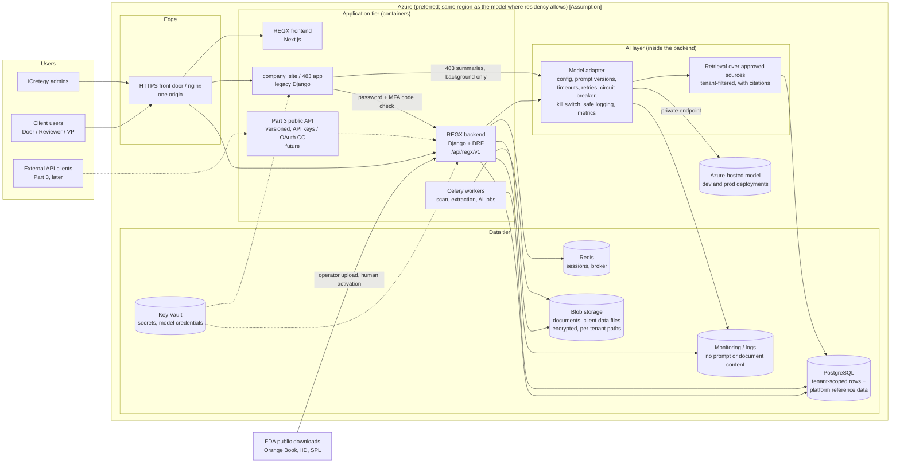

# REGX consolidated execution plan (November 2026)

**For:** Pratham (internal review first). **From:** Maanav, with Claude Code. **Date:** 2026-11-06 (revision 2, same day). **Due:** 2026-11-13.
**Answers:** section 16 (points A–G) of Pratham's direction of 2026-11-06 (`docs/decisions/2026-11-06-pratham-direction.md`).
**Status:** draft for review. Nothing in this plan has been agreed with iCretegy.

**How to read it**
- **Sources:** facts come only from the repository (`regx-main@0e60622`), `PROJECT_OVERVIEW.md`, the SOW (22 April 2026; read from a **local, untracked copy** of the PDF in the working folder, ignored by `.gitignore:130` and never committed on any branch, tag or PR head; checked 2026-11-06), and the decision record. File paths and PR numbers are the evidence.
- **[Estimate]** marks every effort or date figure. **[Assumption]** marks anything not proven. Sizes are for one experienced developer.
- **Status ladder** (Pratham, §12 of his direction): **1** implemented → **2** code review and CI → **3** security and tenant checks → **4** real reference data → **5** regulatory validation → **6** staging → **7** client UAT → **8** written acceptance → **9** production → **10** handover. A row shows the **highest step reached**. Merged code is step 2 at most until the later steps are evidenced. **No item in this plan has reached step 6 or above: there is no staging or production environment.**
- **No compliance or certification claims.** REGX has technical controls (roles, audit trail, tenant isolation). It is not certified for anything (SOC 2, ISO 27001, HIPAA, 21 CFR Part 11).

---

## 1. One-page summary

> **Question for Pratham: is Dev (or another developer) available for this project, and from when?**
> Everything below assumes one developer until you answer. The table shows what a second developer changes.

| Milestone [Estimate] | One developer | Two developers (second from F1) |
|---|---|---|
| First AI demo: redesigned 483 summaries on the Azure model, supervised 20-observation batch | **F8** (15–26 Feb 2027) | **F5** (4–15 Jan 2027) |
| **M2 (40 %)**: minimum Part 1 first release deployed, UAT, written acceptance (section G.1) | **F17** (21 Jun–2 Jul 2027) | **F12** (12–23 Apr 2027) |
| **M3 (40 %)**: Regulatory AI per the agreed Phase 2 scope, deployed, accepted | **F29** (6–17 Dec 2027) or later | **F20** (2–13 Aug 2027) |
| Part 3 API v1 build starts | after M3 (2028) | **F19** (19–30 Jul 2027) |

These dates hold only if: the Azure dev deployment and credentials arrive by the first-AI-demo fortnight; a server with the real 483 dataset is available for the dry run; the regulatory reviewer is named by F6; iCretegy agrees the M2 scope (G.1) and the Phase 2 scope in time; and client-blocked items (calculators, Word add-in, 2.9) are either specified in time or moved out of M3 by agreement. A later second developer moves the two-developer column right by the same amount [Assumption].

**Done (engineering, step 2: merged with CI; not deployed anywhere)**
- **REGX governed platform (SOW Part 2, non-AI):** Doer → Reviewer → VP review gates, IIG checklist engine with calculation registry and gap analysis on checklist answers, FDA reference data (Orange Book and IID importers, SPL route and dosage-form lists), formulations and IID matching, documents with versioning, scanning hooks and text extraction, immutable audit trail, tenant isolation. Full backend suite 4,298 passed / 2 skipped (PR #107 run).
- **Security, last two weeks:** login lockout (#82), schema behind login (#83), loud stub scanner (#84), MFA code at login (#96), loader cannot approve (#97), locked dependencies (#98, #104), pypdf upgrade (#100), text-extraction warnings (#101, #102), base images pinned and backend `.dockerignore` (#106), **MFA mandatory for Reviewer/VP and no self-registration (#107)**, local CSRF fix (#109).
- **Real data, locally only (step 4 locally, not on a shared environment):** Orange Book 48,761 products; IID July 2026, 9,071 rows; 164 IID mapping proposals (none approved).

**Blocked, and on whom**

| Blocked item | Waiting for | Owner |
|---|---|---|
| Any real checklist content going live | 20-item content gate (0 of 20 signed) and Approval Register 13/14 | iCretegy regulatory approver |
| Formally approved terminology mappings (164 IID proposals, Orange Book workbook) | Named Praverse regulatory reviewer | Pratham (to appoint) |
| IID per-day rule (Q8) and INJECTION matching | Written answers | iCretegy (after reviewer check) |
| AI features against a real model; benchmarks | Azure endpoint, model/version, limits, region, dev credentials; data-privacy verification | Azure deployment owner (arranged by Pratham) |
| Calculators (2.3), Word add-in (2.7), stability/impurity (2.9) | Specs with worked examples; 13 contract items; feasibility decision | iCretegy |
| Credential revocation (3 OpenAI keys, SMTP password) | Provider-side action and confirmation | Pratham |
| Branch protection on `regx-main`; GHCR / Render / org-app checks | Repository/org admin, Render account | Pratham |
| Any deployment (staging or production) | Azure subscription owner, billing, region, backup design, budget | Pratham |

**Three biggest risks**
1. **The 40 % + 40 % milestones depend on AI that does not exist yet.** REGX has no model call path; the only 483 AI code is the legacy company_site summariser, which is unsafe to switch on before its redesign (§11 #10, #10e). With one developer the first AI demo on the real model lands in **F8, late February 2027**, and the M2 first release in **F17, late June / early July 2027 [Estimate]** (section D).
2. **IID matching produces no comparisons.** **0 of 9,071 IID records are calculable today**: 5,240 rows carry only a maximum daily exposure (the Q8 per-day rule is not built) and 3,764 have a potency unit that cannot be compared (controlled units are on hold). SOW 2.2 "auto calculation limits" cannot be demonstrated on real data until both exist. **Recommendation: move units up now** rather than keep them on hold; Q8 still needs iCretegy's written answer, but units do not.
3. **Capacity.** **This plan assumes one developer** unless Pratham confirms more. At about 7 effective days per fortnight [Estimate], M2 lands about mid-2027 and M3 about the end of 2027, with the Part 3 API after that (table above). Each extra person unlocks:

| Extra person | What it unlocks earlier [Estimate] |
|---|---|
| +1 developer (backend/AI) | Two tracks in parallel (483/AI and REGX/security/deployment): first AI demo about 6 weeks earlier, M2 about 10 weeks earlier, M3 about 4 months earlier (table above) |
| +1 frontend developer | REGX pages for the four ported APIs (deficiencies, inspections, controlled correspondence, product comparison), 483 UI items (filters, dashboard, history), retiring the 32 legacy sidebar links |
| Part-time DevOps (Azure) | Staging environment, backups, monitoring, CI deploy: the plan's step 6 ("staging demonstrated") becomes possible in Q1 2027 instead of after the feature work |
| Regulatory reviewer (named, not a developer) | Unblocks mapping approvals, content gate preparation, Q8/INJECTION review, white-paper review. No developer can substitute |

**Scope note to resolve:** on 2026-10-08 the owner stated that Parts 1 and 3 are **outside REGX** (`PROJECT_OVERVIEW.md` §0). Pratham's direction now asks for one plan across Parts 1–3 and prefers a unified platform long term (§5 of the direction). This plan covers all three parts and treats "where Part 1 lives" as an open decision (section E, question 9).

---

## A. Technical status against the SOW

Ladder step shown as **"step N"** (see "How to read it"). **Built** = code, API, UI and tests exist; **Partly built**; **Missing**; **Blocked** = a specific external input is missing.

### A.1 Part 1: 483 Database – AI based (lives in legacy `company_site/` today)

Read from code only (routes in `company_site/AIDatabase/urls.py`, views in `company_site/AIDatabase/views.py`, templates); the app was not run for this plan, so "exists" means a route and view exist, not that it was demonstrated. **The only AI call in company_site is the observation summariser** (`company_site/AIDatabase/observation_summary.py:332`, `:350`, OpenAI), which runs on page load and is unsafe to enable before the approved redesign (`docs/LEGACY_483_SUMMARISER_REDESIGN.md`: 5,662 observations pending). Company_site has smoke tests only (41, PR #104).

| SOW | Requirement (short) | Status | Step | Evidence | Gap / blocker |
|---|---|---|---|---|---|
| 1.1 | AI platform on iCretegy 483 data (2009–current, CAPA 2018–2025); attractive UI with light/dark mode; PDF/Excel/Word/PPT input; browser/IP-based user management | Partly built (non-AI database app) | 2 | 483 database pages (`form483/`, `form483_database`, `auditiq/`), warning letters (`warning_letter/`), admin user management with device-token lock (`AdminMaster/views.py` `login`) | No AI platform; data comes from client spreadsheets and the tracked `db.sqlite3` (§11 #10g, #10h); no light/dark mode found; full 2009–current data and CAPA set not confirmed in the repository (question E10) |
| 1.2 | Fast mode (quick summaries) and Think mode (summary, root cause, CAPA, classification) | Missing (summariser only) | 1 | `observation_summary.py` summarises observations with `gpt-4.1-mini` on page load | Redesign (approved), Azure model, Fast/Think modes, root cause/CAPA/classification |
| 1.3 | Search: dataset-only with source and page reference / "No supporting data found"; web-based; both | Missing (keyword filters only) | — | Metadata filters exist (below); ChatGPT synonym search was removed (`AIDatabase/filters.py:12`) | Retrieval with citations, abstention, web search with labelled sources |
| 1.4 | Prompt dictionary; smart follow-ups; question history; top-20 recurring issues, investigator and company intelligence, cGMP 6-system | Partly built (intelligence pages, no prompts or history) | 2 | `top20_recurring/`, `investigator_insights/`, `top10_investigators/`, `top10_companies/`, `system_checklist/`, `render_systempage/` | No prompt dictionary, follow-ups or question history (no chat exists) |
| 1.5 | Tables and pie/column charts; variable format; bad-response/comment feedback; reference guide | Partly built (charts) | 2 | Chart data endpoints (`get_anda_chart_data/`, `pie-chart-*`, `bar-chart-*`), `usfda_guideline/`, `playbook/` | Response feedback; AI responses do not exist |
| 1.6 | New-483 alerts; metadata filters (company, CFR, product type, country, investigator, year, keyword, repeat); home dashboard; pop-up when an answer is ready; accuracy graph; GDPR/HIPAA | Partly built (filters, updates feed) | 2 | Filter lists (`list_of_company/`, `list_of_country/`, `list_of_investigators/`, `list_of_years/`, `list_of_fei_numbers/`, `list_of_systems/`), updates and announcements (`updates-data/`, `checked-updates/`, `active-announcements/`, `_notification_dropdown.html`), dashboards (`auditiq/`, `gmpc_dashboard/`) | Automatic new-483 alerts (no import pipeline, no Celery worker for company_site), personalised dashboard, accuracy graph; GDPR/HIPAA are legal matters (A.4) |
| 1.7 | Skill assessment, guided tour, progressive disclosure, "explain this result" | Missing | — | — | All |
| 1.8 | Session memory, user profile context, multi-turn reasoning (Think: structured explanation, not raw reasoning, per direction §4) | Missing | — | — | Needs chat and the AI layer |
| 1.9 | One-click PDF/Word report, scheduled reports, export PDF/Word/Excel/PPT/JSON, templates | Missing (no export code found) | — | No report or export generator found in `AIDatabase` | All; scheduled reports and templates are "feasibility later" in the SOW |
| 1.10 | Confidence score, source attribution panel, "why did the AI say this" | Missing | — | — | Needs retrieval with citations; the score needs an agreed method (no invented percentages) |
| 1.11 | Voice input, WCAG 2.1 AA, multi-language UI | Missing | — | No speech or translation code found | All. REGX's own pages are axe-checked; company_site is not |
| 1.12 | Alert priority scoring, trend and competitor alerts *(feasibility later)* | Missing | — | — | Feasibility; needs 1.6 alerts first |
| 1.13 | Install on iCretegy's web within 90 days (Day 60 testing, Day 75 real testing, Day 90 go-live) | Missed | — | SOW dated 22 April 2026; 90 days passed on 21 July 2026 | Recovery plan (section D) and an agreed revised date |

### A.2 Part 2: Technical Tools (Regulatory) – AI based (REGX)

| SOW | Requirement (short) | Status | Step | Evidence | Gap / blocker |
|---|---|---|---|---|---|
| 2.1 | AI platform on iCretegy raw data; attractive UI; PDF/Excel/Word/PPT; single module-wise toolkit | Partly built | 2 | 25 backend apps, 47 Next.js page files; document upload with text extraction (`backend/documents/tasks.py`, #101/#102); template source ingestion (`templates_registry`) | No AI layer. Four ported APIs have no REGX page; sidebar mixes in 32 legacy `/ratools/` links (`frontend/src/components/regx-shell/RegxSidebar.tsx`) |
| 2.2 | IIG checklist auto-fill, auto-fetch limits, route mapping, auto-calculate, cite IIG | Partly built (engine built) | 2 (engine); 4 locally for data | `iig_checklist` (about 1,197 tests at an earlier count, overview §13), `iid_assessment` matching, 6-formula registry (`iig_checklist/calculation_registry.py`), IID importer (#89), mappings workflow (#92–#94, #97) | **0 of 9,071 IID records calculable** (Q8 per-day rule, units). Content gate 0/20; Approval Register 13/14 pending; no approved mapping |
| 2.3 | HTML calculators: dissolution, impurity, stability trend | Blocked | — | Intake `docs/CALCULATOR_SPECIFICATION_INTAKE.md` (spec + 3 normal / 2 boundary / 2 invalid examples per calculator) | iCretegy specs and original files (direction §9: 3–5 worked examples each) |
| 2.4 | Doer → Reviewer → VP with review gates, traceable actions | Built | 3 | 5 system roles (`authorization/seed.py`), gates across modules, DB-trigger-immutable history; MFA for Reviewer/VP (#107) | Regulatory validation not applicable; UAT pending |
| 2.5 | Orange Book: minimal inputs → reference data → calculations "like white paper & IIG checklist"; keep FDA data updated | Partly built | 2; 4 locally | Importer fixes #80, metadata #86, real file active locally (48,761 products); public FDA download is the source of record (iCretegy confirmation reported 2026-10-12) | Phase 3 patents/exclusivity, Phase 4 new-data detection, Phase 5 lookup page not started; white-paper spec Q1–Q8 unanswered; Orange Book mappings not approved |
| 2.6 | Chatbot across workflow; single/bulk upload on "iPharmaAI UI" for gap assessment | Missing | — | No LLM code, no chat UI (`PROJECT_OVERVIEW.md` §13) | AI foundation; "iPharmaAI UI" meaning (company_site or REGX) |
| 2.7 | Word plug-in (section guidance, deficiency flags, gap analysis, references, "zero hallucination", versioning) | Blocked | — | `docs/WORD_ADDIN_CONTRACT_INTAKE.md` (13 items) | iCretegy: named owner and 13 contract decisions; depends on SSO/auth design |
| 2.8 a | Gap score 0–100 for uploaded ANDA/DMF documents with section drill-down | Partly built (checklist answers only) | 2 | `iig_checklist/gap_analysis.py`, `/gap-analyses/`; score deliberately withheld as "not governed" | No document pipeline (full-text storage, section split, item matching, scoring); scoring method needs agreement (direction §8) |
| 2.8 b | Predictive deficiency heatmap *(feasibility TBD in SOW)* | Missing | — | Deficiency corpus API exists, empty until imported (`deficiencies`) | Feasibility; data import |
| 2.8 c | AI resolution playbook per gap | Missing | — | — | AI foundation |
| 2.9 | Stability and impurity AI assistant *(feasibility TBD)*; Part 11-style audit of calculator inputs/outputs | Blocked / partly built (audit) | 2 (audit) | `docs/STABILITY_IMPURITY_ASSISTANT_INTAKE.md`; immutable `AuditEvent` | iCretegy feasibility decision; Part 11 question (section E) |
| 2.10 | Smart versioning summary, version diff with AI commentary, auto-tagging *(feasibility TBD)* | Partly built (versioning only) | 2 | `DocumentVersion`, duplicate detection, text extraction | AI foundation; diff view; tag model |
| 2.11 | Timeline "mutually decided" in phase 2 | Open | — | SOW page 9 | Phase 2 scope document (direction §9) |

### A.3 Part 3: API end point creation

| SOW | Requirement (short) | Status | Step | Evidence | Gap / blocker |
|---|---|---|---|---|---|
| 3.1 | API endpoints for iPharmaAI's AI database; per-client API keys; data auto-refreshes | Missing (internal API only) | — | REGX has ~220 session-authenticated routes under `/api/regx/v1/` for its own UI; **no API key model, no client credentials** (no such model in `backend/`) | Part 3 architecture (section C); which data is exposed |
| 3.2 | REST + OpenAPI 3.0 explorer; versioning; 30-day sandbox; rate tiers *(tiers: feasibility TBD)* | Partly built | 2 | drf-spectacular schema and Swagger at `/api/docs/` (behind login in production, #83); URL prefix `v1` | Public developer portal, sandbox environment, rate tiers (only one throttle exists: `external_execution_create` 60/min, `regx/settings/base.py`) |
| 3.3 | OAuth 2.0 client credentials + API keys; per-key scopes; IP allow-list; TLS 1.3, AES-256 at rest | Missing | — | Session cookies only (`SessionAuthentication`) | All. Note: the MFA gate assumes session-only auth; adding token auth must extend it (§11 #10l, `docs/MFA.md`) |
| 3.4 | Webhooks (new_483_published, alert_triggered, report_ready), delivery dashboard | Missing | — | `external_integrations` is **outbound connectors** for REGX's own workflows, not customer webhooks | Depends on Part 1 events existing |
| 3.5 | Native integrations (Veeva, MasterControl, Salesforce, Teams, Slack), Zapier/Make, embeddable widget | Missing | — | `external_integrations` connector framework could host some [Assumption] | Phased acceptance (direction §11) |
| 3.6 | Timeline: after the software is generated | — | — | SOW page 11 | — |

### A.4 Sections 4–6 (enhancements)

| SOW | Requirement (short) | Status | Step | Evidence | Gap / blocker |
|---|---|---|---|---|---|
| 4.1 | SOC 2 Type II in 12 months, ISO 27001 roadmap, GDPR DPA, HIPAA BAA, 21 CFR Part 11 | Missing (contractual) | — | None | **Needs legal/quality/management action, not code** (direction §10). Do not claim any of these |
| 4.2 a | Hard tenant isolation (documents, query history, API keys) | Built for existing data | 3 | Fail-closed `TenantMiddleware`; test files that exercise another tenant exist in 16 apps (e.g. `iig_checklist` 19 files, `documents` 5, `external_integrations` 6; counted 2026-11-06 by searching tests for other-tenant cases); self-service tenant creation removed (#107) | No query history, chat history, summaries or client API keys exist yet; their isolation tests come with them. No single consolidated isolation suite (appendix) |
| 4.2 b | No training on customer data without written opt-in | Not applicable yet | — | No AI in REGX | Azure data-privacy gate (`docs/AZURE_MODEL_INTEGRATION_CHECKLIST.md` §7) |
| 4.2 c | No Praverse-staff access to customer documents without VP-approved, audited break-glass | Partly built | 2 | `platform_support` metadata-only for documents (`documents/permissions.py`) | Break-glass flow; infrastructure access controls |
| 4.3 a | SSO (SAML 2.0 / OIDC) | Missing | — | The company_site "SSO" is only a shared password check | L [Estimate]; client IdP details |
| 4.3 b | MFA enforced for Reviewer and VP; configurable for all roles | Built (REGX) | 2 | #96 (code at login), #107 (mandatory for Reviewer/VP, `/mfa/setup`) | **Deployment blocker:** company_site login has no code step, so enrolled Reviewers/VPs are locked out there (§11 #10k). Admin/privileged-account MFA not covered (appendix). Not configurable per role yet |
| 4.3 c | Granular feature-level RBAC | Built (code-defined) | 2 | Per-module `permissions.py` codenames | Not admin-configurable; no "manage API keys"/"export reports" permissions yet |
| 4.4 a | Immutable audit log of every query, response, export, action, admin change with user, time, IP | Partly built | 2 | `AuditEvent` immutable by DB triggers; domain mutations logged | Reads/queries not logged; login/logout not logged |
| 4.4 b | Audit export JSON/CSV; 7-year retention | Missing | — | No audit API (`audit:view` seeded, unused) | Retention policy decision (`docs/REGX_OWNER_POLICY_DECISION_PACKAGE.md`) |
| 4.4 c | Compliance dashboard with anomaly alerts | Missing | — | — | L [Estimate] |
| 5.1 | Fast < 5 s p95, Think < 10 s p95, upload+index < 30 s / 50 pages, API < 2 s p95, 99.9 % uptime, alerts < 15 min | Not measured | — | `docs/PERFORMANCE_BASELINE.md` measures structure only | Benchmarks need the Azure model; uptime needs a deployment |
| 5.2 | Cloud-native on AWS/Azure with auto-scaling; CDN; DR RPO < 1 h, RTO < 4 h; PWA | Missing | — | Docker Compose only; backups manual (§11 #13) | Azure architecture and budget (section C) |
| 6.1 | Subscription tiers *(tentative)* | Missing | — | — | Commercial decision |
| 6.2 | NPS, adoption tracker, in-app changelog *(feasibility TBD)* | Missing | — | — | Later |
| 6.3 | Thumbs up/down + comments on every AI response; monthly accuracy report; quarterly model report | Missing | — | — | Comes with the AI foundation (feedback capture in Stage 1) |
| Maint. | 1 year maintenance after deployment; 24×7 from year 2 | — | — | SOW page 16 | Support model and on-call to be defined before go-live |

---

## B. Ready to start now vs blocked

**Ready now (no further approval needed: covered by Pratham's approval of "immediate safety and foundation work")**

| Item | Why it is unblocked | Size [Estimate] |
|---|---|---|
| Admin and privileged-account MFA policy (tenant_admin, platform_support) | Direction §10 | S (1 day) |
| Remove the leaked `django-insecure` fallback in `company_site/RAAI/settings.py` (refuse to start without `SECRET_KEY`) | Direction §3C "disable wherever we control the configuration" | S (0.5 day) |
| Clean duplicate tenant-scoped roles; constrain `is_system ⇒ tenant IS NULL`; fix `seed_regx_demo` lookup | §11 #25; found again 2026-11-06 | S (1 day) |
| company_site MFA code step (design in §11 #10k) | Unblocks enforcing #107 anywhere real | M (3–4 days) |
| Legacy 483 summariser redesign (disabled by default; no key connected), **built on the common AI layer** | Approved, direction §2; direction §4 point 10 (one interface) | 6.5–8 days + ~3 days review, once the AI foundation exists (its model adapter moves into the foundation) |
| Clean reproducible company_site seed replacing `db.sqlite3` | Approved, direction §3A (history already inspected, §11 #10h) | ~1 week |
| Client spreadsheets out of the company_site image (mounted data path) | Direction §3B | S–M (1–2 days) |
| **Controlled units** (model, migration, loader, mapping proposals) | Recommended to move up (summary); no client input needed to build | M–L (1.5–2 weeks) |
| VP-only bulk approval of mappings | Approved, direction §6B | S–M (2–3 days) |
| AI foundation against a **stub** provider (adapter, config, kill switch, safe logging, metrics, prompt versions, tenant guard, feedback capture), plus an internal service endpoint so company_site uses the same layer | Approved, direction §4 | 2–3 weeks + 2–3 days for the internal endpoint |
| Orange Book Phase 3: patents and exclusivity (import + reference tables) | Direction §7 supports structured tables | M–L (1–2 weeks) |
| Part 3 API architecture document | Direction §11 | S–M (2–3 days) |
| Consolidated cross-tenant negative test suite | Direction §10 | M (2–3 days) |
| Phase 2 scope and acceptance document; Part 1 delivery checklist | Direction §5, §9 | M (3–5 days, writing) |
| openFDA API key registration | Approved, direction §7 | S (Pratham registers; we store it as a secret) |

**Blocked**

| Item | Blocker | Owner |
|---|---|---|
| Real model integration, benchmarks, summariser dry run and 20-observation batch | Azure details, dev credentials, privacy verification; a server with the real dataset | Azure deployment owner; Pratham |
| Approving the 164 IID mappings and the Orange Book workbook | Named regulatory reviewer | Pratham |
| Q8 per-day comparison going live | iCretegy answer after reviewer check | iCretegy; regulatory reviewer |
| INJECTION matching behaviour | iCretegy written confirmation | iCretegy |
| White-paper build (Q1–Q8, 92-question bank, combination appendix) | Reviewer check, then iCretegy Accept/Amend/Reject | Regulatory reviewer; iCretegy |
| Real checklist content (content gate 0/20, Register 13/14) | iCretegy regulatory approver | iCretegy |
| Calculators (2.3) | Specs, originals, 3–5 worked examples each | iCretegy |
| Word add-in (2.7) | Named client owner + 13 contract items | iCretegy |
| Stability/impurity assistant (2.9) | Feasibility decision | iCretegy |
| Document gap analysis build (2.8a) | Feasibility test result + agreed scoring method + full-text storage decision | Pratham; iCretegy |
| Deployment (staging, production) | Azure subscription owner, billing, region, backup design, budget | Pratham |
| Branch protection; GHCR/org-app/Render checks; credential revocation | Admin/account access | Pratham |

---

## C. Architecture

**Principles (from the direction):** one model-agnostic AI layer used by every feature; client data never inside images; tenant isolation everywhere; dev/staging/production separated; AI off by default and switchable by an administrator.

**Data flows**
- **FDA reference data:** operator downloads the public FDA file → import as a new release → Doer validates → Reviewer/VP approve → VP activates. Platform-level (no tenant). Loader cannot approve or activate (#97).
- **Client documents and data files:** uploaded through the app (or a protected mounted volume for legacy spreadsheets) → malware scan → text extraction → stored per tenant in blob storage. **Never baked into an image** (`backend/.dockerignore`, #106; company_site spreadsheets still to move, section B).
- **AI requests:** feature → adapter → retrieval restricted to the caller's tenant and approved platform sources → model → response with citations → stored with model/prompt version, latency and token counts; **no prompt or document text in logs** unless approved and protected (direction §4.6).
- **483 summaries:** background job only, never on page load, disabled by default, idempotent, with limits and a kill switch (`docs/LEGACY_483_SUMMARISER_REDESIGN.md`). company_site does **not** get its own model adapter: its job calls the REGX AI layer through an internal, authenticated service endpoint on the private network, so model configuration, kill switch, logging rules and metrics are the same for 483 and REGX features (direction §4 point 10). The company_site container never holds model credentials.
- **iPharmaAI integration (Part 3):** a separate public API surface (API keys or OAuth client credentials, per-key scopes and rate limits, sandbox and production) in front of the same services. Not built.

**Model access**
- Credentials in Key Vault (or environment on the server), separate for dev and prod, delivered only over a secure channel (`docs/AZURE_MODEL_INTEGRATION_CHECKLIST.md` §6).
- Private endpoint or IP allow-list to the model [Assumption, pending checklist §7.7].
- **Privacy gate:** no client data to the model until storage, logging, retention, inspection and training settings are verified and recorded (checklist §7).

**Tenant isolation**
- Every tenant-scoped row has a tenant FK; `TenantMiddleware` fails closed; per-module permissions check membership.
- AI retrieval and stored AI outputs (chat history, summaries, explanations) are tenant-scoped from day one, with negative tests.
- Platform corpora (FDA data, deficiencies, inspections) are shared reference data with no tenant FK, by design.

**Environments [Assumption until the Azure owner confirms]**

| Environment | Purpose | Data | Model |
|---|---|---|---|
| Local / CI | Development, automated tests | Synthetic + public FDA data | Stub provider; CI never holds a key |
| Dev (Azure) | Integration with the real model, benchmarks | Synthetic and public data only until the privacy gate passes | Dev deployment |
| Staging | Client UAT, demos | Approved test data; client data only after privacy gate and written approval | Prod-like deployment |
| Production | Live use | Client data | Prod deployment |

**Where the 483 application sits:** today a separate legacy Django app sharing only the password check with REGX. Pratham prefers a unified platform long term (direction §5); this plan keeps it separate for now and routes its AI through the same adapter, so migration later does not duplicate the AI layer. Decision in section E.

---

## D. Roadmap (fortnightly milestones)

**Capacity [Estimate]:** about 9 working days per fortnight, of which about 7 go to engineering after reviews, the fortnightly project review, client questions and documentation. F4 (late December) is planned at half capacity. Dates are targets, not commitments, and move when a blocker in section B is not cleared in time.

**Why this order:** the AI foundation comes first because the direction asks for one AI interface shared by REGX features and 483 summarisation (§4 point 10), so the summariser redesign is built on that layer instead of growing its own adapter that would later be thrown away; units move back accordingly.

### D.1 One developer (the default assumption)

| Fortnight | Dates | Work [Estimate] | Needs |
|---|---|---|---|
| **Every fortnight** | — | **Fortnightly project review with a short demo of completed work and a written record of decisions and blockers** (direction §16; about half a day, inside the capacity above) | Pratham; iCretegy when the SOW meeting cadence applies |
| F1 | 9–20 Nov 2026 | Admin/privileged MFA; leaked company_site fallback key removed; duplicate roles fixed; **company_site MFA code step**; this plan reviewed; Azure checklist sent | — |
| F2 | 23 Nov–4 Dec | **AI foundation (stub provider)**, part 1: adapter interface, configuration, kill switch, timeouts/retries/circuit breaker | — |
| F3 | 7–18 Dec | **AI foundation**, part 2: safe logging, metrics, prompt versions, tenant guard, feedback capture, evaluation harness | — |
| F4 | 21 Dec–1 Jan (½) | Internal AI service endpoint for company_site; VP bulk approval | — |
| F5 | 4–15 Jan 2027 | **483 summariser redesign on the AI layer** (tables, read-only page, batch job, import hook) | — |
| F6 | 18–29 Jan | Summariser tests and finish; **units** start; client spreadsheets out of the image | — |
| F7 | 1–12 Feb | **Units** finish (moved back from F3–F5); cross-tenant suite | Reviewer for unit mappings |
| F8 | 15–26 Feb | **Benchmarks** on the Azure dev model; summariser **dry run + 20-observation batch** → **first AI demo** | Azure dev access; server dataset |
| F9–F10 | 1–26 Mar | **Fast and Think modes** for 483 (structured summary, root cause, CAPA, classification; source-supported vs AI-suggested labelled) | Azure; reviewer for examples |
| F11–F12 | 29 Mar–23 Apr | **Dataset search with citations and "No supporting data found"**; response feedback | — |
| F13 | 26 Apr–7 May | Evaluation set and accuracy review; clean company_site seed | Reviewer |
| F14–F15 | 10 May–4 Jun | **Azure staging and production** for the M2 release (backups, monitoring, runbook) | Azure subscription, budget |
| F16–F17 | 7 Jun–2 Jul | **UAT with iCretegy**, fixes, written acceptance → **M2** | iCretegy users |
| F18–F21 | 5 Jul–10 Sep | Explain This Gap (F18); contextual chatbot v1 (F19–F21) | Approved checklist content for real use |
| F22–F27 | 13 Sep–19 Nov | Document gap analysis feasibility (F22); Orange Book patents/exclusivity (F23); document gap analysis build if agreed (F24–F27) | Representative documents; agreed scoring method |
| F28–F29 | 22 Nov–17 Dec | Part 2 staging, UAT, acceptance → **M3** | Phase 2 scope signed |
| Later | 2028 | Part 3 API v1; Part 1 later deliverables (G.1) | — |

Q8 (3–5 days) and white-paper items slot into the first fortnight after iCretegy answers, displacing the lowest item in that fortnight.

### D.2 Two developers (if a second developer joins from F1)

| Fortnight | Developer A: AI and 483 (Part 1) | Developer B: REGX, security, deployment |
|---|---|---|
| **Every fortnight** | **Fortnightly project review with demo** (both attend) | |
| F1 | AI foundation (stub), part 1 | Admin MFA; leaked key; duplicate roles; company_site MFA code step |
| F2 | AI foundation, part 2; internal endpoint | VP bulk approval; cross-tenant suite |
| F3 | Summariser redesign on the AI layer | Spreadsheets out of image; clean company_site seed |
| F4 (½) | Summariser finish | Units start |
| F5 | Benchmarks; dry run + 20 batch → **first AI demo** | Units finish |
| F6–F7 | Fast and Think modes | Orange Book patents/exclusivity; Azure environment set-up starts |
| F8–F9 | Dataset search with citations; feedback | Azure staging and production; backups, monitoring |
| F10 | Evaluation set and accuracy review | Explain This Gap |
| F11–F12 | UAT fixes; written acceptance → **M2** | Explain This Gap finish; document gap feasibility |
| F13–F15 | Contextual chatbot v1 | Document gap analysis build (if agreed) |
| F16–F18 | Chatbot finish; Part 1 later deliverables start | Document gap analysis build continues |
| F19–F20 | Part 3 API v1 starts | Part 2 staging, UAT, acceptance → **M3** |

**Effort per named item [Estimate]**

| Item | Effort | Depends on |
|---|---|---|
| company_site MFA code step | 3–4 days | — |
| AI foundation (stub provider) | 10–15 days | — (Azure only for live use) |
| Internal AI service endpoint for company_site | 2–3 days | AI foundation |
| 483 summariser redesign on the AI layer | 6.5–8 days + ~3 days review/integration | AI foundation |
| Dry run, 20-observation batch, accuracy review, backfill | 3–5 days spread over two fortnights | Azure model; server dataset; reviewer time |
| Fast and Think modes (483) | 10–15 days | AI foundation; Azure |
| Dataset search with citations and abstention (483) | 10–15 days | AI foundation |
| Response feedback | 2–3 days | AI foundation |
| Azure staging and production for M2 | 10–15 days | Subscription, budget, backup decisions |
| Clean company_site seed | ~5 days | — |
| Controlled units | 7–10 days | Reviewer to approve unit mappings |
| Q8 per-day rule | 3–5 days | iCretegy answer |
| Benchmarks (Fast/Think, concurrency, long context) | 3–5 days | Azure dev deployment |
| Explain This Gap | 7–10 days | AI foundation; approved checklist content for real use |
| Contextual chatbot v1 | 15–20 days | AI foundation; retrieval sources |
| VP bulk approval | 2–3 days | — |
| Orange Book patents and exclusivity | 5–10 days | — |
| Document gap analysis feasibility test | 5 days | Representative documents; Azure OCR access |
| Document gap analysis build | 5–8 weeks | Feasibility result; agreed scope and scoring method |
| API architecture document | 2–3 days | — |
| API v1 | 3–5 weeks | Architecture agreed; capabilities to expose |

**Dependencies that move dates most:** Azure access (first-AI-demo fortnight), named regulatory reviewer (by F6), iCretegy agreement on the M2 scope (G.1) and the Phase 2 scope, and whether and when a second developer joins.

---

## E. iCretegy question pack

Owner column: who must answer. "Proposed answer" is ours, for them to accept, amend or reject in writing.

| # | Question | Proposed answer | Owner (decides) | Our contact | Source |
|---|---|---|---|---|---|
| 1 | **INJECTION:** Orange Book route "INJECTION" vs specific IID routes | Fixed reviewer-approved list of injectable routes; show every matching IID record with its own route and limit; never auto-pick the highest; reviewer confirms the actual route | iCretegy (after Praverse reviewer check) | Pratham | `docs/TERMINOLOGY_VOCABULARY_DECISION.md` §4 |
| 2 | **Q8:** IID limit per unit or per day | Per-unit when a potency limit exists; per-day (amount per unit × max units per day vs maximum daily exposure) when a daily limit and a structured maximum daily dose exist; otherwise "cannot compare". Report "at or below / above" with numbers and source, never "acceptable" | iCretegy + Praverse reviewer | Pratham | `docs/ORANGE_BOOK_WHITE_PAPER_SPEC.md` Q8 |
| 3 | **White-paper spec Q1–Q7**, the 92-question bank and the combination-product appendix | As proposed in the spec: no White Paper calculations beyond those approved; reuse the IIG checklist engine; structured patent/exclusivity tables; formulas owned and signed by iCretegy; port the 92 questions and appendix as versioned content | iCretegy (named signatory for Q4) | Pratham | `docs/ORANGE_BOOK_WHITE_PAPER_SPEC.md` |
| 4 | **IID source:** written approval that the public FDA IID download is the source of record (as for the Orange Book) | Yes: public FDA download, operator upload, human activation | iCretegy | Pratham | Direction §7 |
| 5 | **20-item content gate** and Approval Register 13/14 | Named iCretegy regulatory approver; sign item by item | iCretegy regulatory approver | Pratham | `docs/REGULATORY_CONTENT_GATE_20_ITEM_DECISION_INTAKE.md`, `docs/APPROVAL_REGISTER_13_14_DECISION_INTAKE.md` |
| 6 | **Calculators** (dissolution, impurity, stability trend) | Send the original HTML files and 3–5 worked examples per calculator; complete the intake form; name the formula owner | iCretegy | Pratham | `docs/CALCULATOR_SPECIFICATION_INTAKE.md` |
| 7 | **Word add-in** | Name a client owner; answer the 13 contract items (auth, tenant, distribution, Desktop vs Online, provenance, "zero hallucination" definition) | iCretegy | Pratham | `docs/WORD_ADDIN_CONTRACT_INTAKE.md` |
| 8 | **21 CFR Part 11** | Contract needs technical controls (audit trail, access control, e-signature meaning) delivered and documented; any formal attestation is a separate quality/legal activity, not part of the software delivery | iCretegy + Praverse management | Pratham | SOW 2.9, 4.1; overview §12 Q13 |
| 9 | **ipharmaai.com and the legacy 483 app:** is it the live system, and should REGX replace it or sit beside it? | Keep separate now; share login, AI layer and data services; plan a unified platform after a costed migration study | iCretegy + Pratham | Pratham | Overview §12 Q12; direction §5 |
| 10 | **AIDatabase export:** a corrected export, a snapshot including warning letters, and 483 data 2009–current with CAPA 2018–2025 | Provide as files through a secure channel; we import with provenance and checksums | iCretegy | Pratham | Overview §12 Q11; SOW 1.1 |
| 11 | **2.6 "iPharmaAI UI":** where the upload-and-gap-assessment lives | REGX frontend, exposed to iPharmaAI through the Part 3 API | iCretegy | Pratham | Overview §13 |
| 12 | **Stability/impurity assistant (2.9) feasibility** | Defer to Phase 2; decide after calculators exist | iCretegy | Pratham | `docs/STABILITY_IMPURITY_ASSISTANT_INTAKE.md` |
| 13 | **"Zero hallucination" (1.3a, 2.7)** | Replace with measurable grounding: every dataset answer cites a source or returns "No supporting data found"; accuracy measured on an agreed evaluation set (direction §5) | iCretegy | Pratham | SOW 1.3, 2.7 |
| 14 | **Payment milestone 1 wording:** "20 % after completion of 2 milestones (483 AI) i.e., after 1 month": which two milestones? | Ask for the two named milestones in writing | iCretegy + Pratham | Pratham | SOW page 15 |

---

## F. Validation approach

| Area | Method | Pass criteria (proposed) | Needs |
|---|---|---|---|
| **Model quality** | Regulatory-reviewed evaluation set per feature (483 summaries, Explain This Gap, chatbot): straightforward, long, ambiguous and unsupported cases; score factual accuracy, citation correctness, completeness, abstention when unsupported; CAPA usefulness for 483 | Thresholds agreed with Pratham and iCretegy before build; every dataset answer cites a source or abstains | Reviewer time; Azure dev model |
| **FDA matching accuracy** | End-to-end runs on real FDA files: Orange Book selection → route/form mapping → IID candidates → units → calculation → review → activation; worked examples: match, ambiguous, no data, incompatible units, needs human review | Every example's result matches a reviewer's manual answer; nothing auto-picked | Approved mappings; Q8; units |
| **Regulatory correctness** | Reviewer checks calculations, thresholds and wording; regulatory-claim guard tests (`common/tests/test_regulatory_claim_guard.py`) stay green | Written reviewer sign-off per module; no "acceptable/approved/compliant" outputs | Named reviewer |
| **Performance** | Load tests end to end (UI request to answer): short queries, long regulatory queries, retrieval, large documents; concurrency 1/5/10/25 [Estimate]; plus upload+index of a 50-page PDF and API p95 | Fast < 5 s p95, Think < 10 s p95 (SOW 5.1); upload < 30 s / 50 pages; API < 2 s p95. Shortfalls reported with bottlenecks before any commitment | Azure dev deployment; plan in `docs/AZURE_MODEL_INTEGRATION_CHECKLIST.md` §9 |
| **Security and tenant isolation** | Consolidated cross-tenant negative suite (read, write, export, AI outputs); MFA gate tests (#107) and real-session test logins (§11 #10l); dependency audit; secret scanning; pre-flight `check_env.py --production` | No cross-tenant read; every Reviewer/VP write needs MFA; 0 high/critical advisories at release | — |
| **Production readiness** | Staging deployment with migrations, backups and restore test, monitoring and alerts, runbook, rollback; UAT script with iCretegy | Restore tested within the agreed RTO; monitoring live; UAT signed | Azure environment; backup policy decisions |

---

## G. Milestone reconciliation and acceptance matrix

SOW fee INR 17,00,000; milestones 20 % / 40 % / 40 % (SOW page 15). **The payments column is for Pratham to fill.**

| Milestone (SOW wording) | Technically done | Demonstrated to iCretegy | Written acceptance | Outstanding | What completion means (proposed, to agree with iCretegy) | Payment received (Pratham) |
|---|---|---|---|---|---|---|
| **M1: 20 % "after completion of 2 milestones (483 AI) i.e., after 1 month"** | Unclear which two milestones (question E14). Legacy 483 app exists in `company_site/`; 483 AI limited to an unsafe summariser | Not recorded in the repository | Not recorded | Definition of the two milestones | The two named milestones, demonstrated and accepted in writing | |
| **M2: 40 % "after deployment of 483 AI"** | No: summariser redesign not built; Fast/Think modes, dataset search with citations, filters, dashboards, exports per SOW 1.2–1.12 largely missing (A.1) | No | No | Part 1 feature set per agreed checklist; Azure model; deployment | The minimum first release in **G.1**, deployed on Azure for iCretegy, UAT signed, written acceptance; every other Part 1 item listed as a later deliverable, not dropped. Target **F17 (one developer) / F12 (two) [Estimate]** | |
| **M3: 40 % "after deployment of Regulatory AI Software"** | Partly: governed non-AI platform built (A.2); no AI; not deployed | Not recorded | No | AI features (2.6, 2.8, 2.10), blocked items (2.3, 2.7, 2.9) per Phase 2 scope; deployment | Signed Phase 2 scope (committed / specification-dependent / feasibility-dependent / change requests), committed items deployed, UAT and written acceptance. Target **F29 or later (one developer) / F20 (two) [Estimate]** | |
| Part 3 API | Not a payment line on its own (bundled in the fee) | — | — | Everything in A.3 | Per phased acceptance plan (direction §11) | |
| Maintenance | — | — | — | Starts at deployment | 1 year included; 24×7 support from year 2 at INR 1,50,000/year (SOW page 16) | |

**Do not present** a repaired summariser as Part 1 delivery, or merged code as accepted (direction §14, §15).

### G.1 Proposed minimum first release for M2 (40 %)

**For iCretegy to agree in writing.** A concrete, testable first release of the 483 AI; everything else in SOW Part 1 stays in scope as a named later deliverable.

**In the first release**

| # | Capability | SOW | Acceptance test (proposed) |
|---|---|---|---|
| 1 | **Redesigned 483 summaries**: background generation on the common AI layer, stored with model and prompt version; never generated on page load; disabled by default until approved | 1.2 | No page triggers a model call (automated test); summaries visible for the agreed observation set |
| 2 | **Fast mode** (quick summary) and **Think mode** (structured: summary, root cause, CAPA, classification), with source-supported findings shown apart from AI suggestions; no invented root cause or CAPA when evidence is insufficient | 1.2 | Reviewer-scored evaluation set passes the agreed thresholds; Fast < 5 s p95 and Think < 10 s p95 end to end, or measured results and an agreed exception |
| 3 | **Dataset search with citations**: answers from the iCretegy 483 dataset only, each citing the source record (and page or section where the source has one); "**No supporting data found**" when nothing supports an answer | 1.3 a | Every answer in the evaluation set cites a source or abstains; citations open the cited record |
| 4 | **Existing filters, intelligence pages and dashboards** (company, country, investigator, year, FEI, system; top-20 recurring; investigator and company insights; charts), carried into the release as they are | 1.4, 1.5, 1.6 (part) | UAT script passes on the deployed system |
| 5 | **Response feedback**: thumbs up/down and comment on every AI response, stored for the monthly accuracy report | 1.5, 6.3 | Feedback recorded and exportable |
| 6 | **Deployed on Azure** for iCretegy (staging for UAT, then production), with backups, monitoring, MFA for Reviewer/VP and the company_site code step, no client data in images | 1.13, 5.2 (part) | Restore test passes; UAT signed; **written acceptance** |

**Later deliverables (not dropped; dates to agree in the Phase 2 / Part 1 schedule)**

| SOW | Item |
|---|---|
| 1.1 | Light/dark mode; ingestion of PDF/Word/PPT 483 sources beyond the current data set; browser/IP user management review |
| 1.3 b, c | Web search and combined dataset + web search with labelled sources |
| 1.4 | Predefined prompt dictionary; related questions and smart follow-ups; question history panel |
| 1.5 | Variable response formats with tables and charts generated per answer; installed reference guide |
| 1.6 | Automatic new-483 alerts; personalised home dashboard (KPIs, recent searches, trending topics); pop-up when an answer is ready; accuracy graph |
| 1.7 | Skill assessment, guided tour, progressive disclosure, "explain this result" |
| 1.8 | Session memory, user profile context, multi-turn reasoning (shown as a structured explanation, not raw model reasoning) |
| 1.9 | One-click PDF/Word reports, export formats (PDF, Word, Excel, PPT, JSON), scheduled reports and templates *(the last two "feasibility later" in the SOW)* |
| 1.10 | Confidence score (with an agreed method, not an invented percentage), source attribution panel, "why did the AI say this" |
| 1.11 | Voice input, WCAG 2.1 AA, multi-language UI |
| 1.12 | Smart alerts: priority scoring, trend and competitor alerts *(feasibility later in the SOW)* |
| 1.6, 4.1 | GDPR/HIPAA: legal and contractual actions, not software features |

**Target [Estimate]:** **F17 (21 Jun–2 Jul 2027) with one developer; F12 (12–23 Apr 2027) with two.** Both assume Azure access by the first-AI-demo fortnight and iCretegy's agreement to this scope by about F6.

---

## Appendix: open items from the direction not yet built

| Item | Direction ref | Size [Estimate] | Plan slot |
|---|---|---|---|
| MFA policy for administrative and privileged accounts (tenant_admin, platform_support); today only Reviewer/VP are gated | §10 | S (1 day) | F1 |
| Consolidated cross-tenant negative tests (documents, FDA assessments, exports; chat history, summaries and API credentials as they are built) | §10 | M (2–3 days) |F7 (one developer) / F2 (two) |
| Branch protection on `regx-main` (required checks, controlled merges, no force-push, no deletion) | §10 | S (Pratham, admin) | F1 |
| Remove the leaked `django-insecure` fallback in `company_site/RAAI/settings.py:29`; refuse to start without `SECRET_KEY` | §3C | S (0.5 day) | F1 |
| Clean the duplicate tenant-scoped roles (`praverse-demo` roles 6–8, `is_system=True`); add a constraint; fix `seed_regx_demo` | §11 #25 (overview) | S (1 day) | F1 |
| company_site MFA code step (deployment blocker for #107) | overview §11 #10k | M (3–4 days) | F1 |
| Test logins through real sessions so the MFA gate is exercised (about 40 files use `force_authenticate`) | overview §11 #10l | M | F3 onward, alongside other work |
