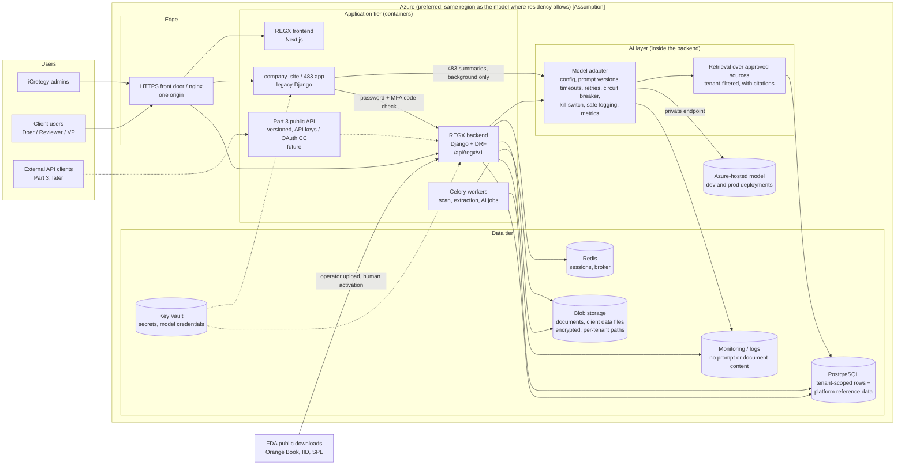

# REGX execution plan, version 2 (November 2026)

**For:** Pratham. **From:** Maanav, with Claude Code. **Date:** 2026-11-06 (version 2; version 1 was merged in PR #110).
**Answers:** section 12 (A–G) of Pratham's second direction, `docs/decisions/2026-11-07-pratham-direction-2.md`; first direction `docs/decisions/2026-11-06-pratham-direction.md`.
**Engineering detail:** `docs/PROJECT_TRACKER.csv` (full tracker); `docs/IID_BLOCKER_ANALYSIS.md`; `docs/CONTROLLED_UNITS_DESIGN.md`; `docs/REGULATORY_REVIEW_PACKAGE.md`; `docs/AZURE_MODEL_INTEGRATION_CHECKLIST.md`; `docs/CREDENTIAL_INVENTORY.md`.

**Rules of this document**
- Facts come from the repository, `PROJECT_OVERVIEW.md`, the decision records and a local, untracked copy of the SOW. **[Estimate]** marks every effort or date; **[Assumption]** marks anything unproven. Sizes assume one experienced developer.
- **All M2/M3 dates are internal estimates, not commitments to iCretegy** (direction §11). The reduced first release is **not** an agreed SOW revision until iCretegy agrees in writing.
- Status ladder: implemented → CI → security → real data → regulatory validation → staging → UAT → acceptance → production → handover. **Nothing has reached staging; no environment exists.**
- No compliance or certification claims.

---

## Management view (one page)

> **Correction found 2026-11-13, read this first.** The read-only scan of related org repositories found **`483-AI-final`**, a separate, private and **active 483 AI codebase** (2,760 commits, 150 branches, last push 2026-11-06; backend, frontend, evaluation and "think" acceptance sets, client QA reports, iCretegy feedback reconciliation, production compose files). This plan's Part 1 status (Annex 1, A.1) and the 483 work in sections B–C were written from `company_site/` alone and **assume the 483 AI is built from scratch**. If `483-AI-final` is the 483 product, Part 1 status, effort and the M2 dates change, possibly a lot. **Decision G2 below; no Part 1 date in this document should be used until it is answered.**

**Progressing**
- **company_site MFA code step live-checked on 2026-11-13: 8/8** (an enrolled VP signs in to company_site with a code). The first live run found a real bug (HTTP 500 from duplicate session cookies), fixed in #114 with a test that reproduces it.
- **Security fixes, all with tests, open for review:** company_site no longer starts without a secret key (#111); duplicate tenant-scoped roles merged and forbidden (#112); MFA for Tenant Admin and Platform Support (#113); **company_site MFA code step** (#114, the deployment blocker from #107). MFA recovery (recovery codes at sign-in, audited admin reset) built on its own branch, not pushed.
- **Regulatory data:** real FDA IID (9,071 rows) and Orange Book (48,761 products) load locally; blocker breakdown done (below); units design ready to build.
- **Planning:** this plan, the regulatory review package (one document for the reviewer and iCretegy), the Azure checklist.

**Blocked (on whom)**

| What | Blocked on | Owner |
|---|---|---|
| First AI demo on the real model | Azure dev endpoint, model/version, dev credential (secure channel), the "before synthetic data" answers (section E.1) | Azure owner, via Pratham |
| Any mapping approval; any real IID comparison | Named regulatory reviewer | Pratham |
| Per-day IID comparisons (4,059 records) | Q8 written answer | iCretegy (after reviewer) |
| Real checklist content | 20-item gate, Register 13/14 | iCretegy |
| Staging environment | Azure subscription owner, budget | Pratham |
| Credential revocation proof; image/registry/Render checks | Account owners (section A.2–A.3) | Pratham |

**Needs your decision (prioritised; detail in section G)**
1. **Revoke the two Google API keys** (the Gemini key in the PUBLIC repo `iCretegy-AI483` and a different one in the private `483-AI-final`). For the public one: (history, `backend/.env`), and decide whether that repo stays public. The read-only scan of all related repos is done (`docs/CREDENTIAL_INVENTORY.md` §8): the 3 OpenAI keys and client spreadsheets ("For Cipla") are also in the private `booking-demo-final` and `Django-booking-demo-page`; neither public repo holds them.
2. **Which codebase is the 483 product?** `483-AI-final` (separate repo, active) or a build inside company_site/REGX as this plan assumes. Answer before using any Part 1 date.
3. **Staffing:** is Dev (or another developer) available, and from when? Part-time Azure/DevOps?
4. **Azure:** subscription owner, budget, and the dev model endpoint + credential.
5. **Regulatory reviewer:** name and start date.
6. **Credentials:** confirm revocation with the checklist in A.2 (now including two Google API keys).
7. **Admin access** for the checks in A.3 (GHCR: look for `ipharmai-api` / `ipharmai-nginx`).
8. **Units:** confirm the move-up (scenario 1 places units right after the 483 MVP; before it costs about 1.5 fortnights on the 483 dates).
9. **M1 definition** and the delivery-stage agreement with iCretegy (section F).

**Dates at a glance [internal estimates]**

> **2026-11-13: every Part 1 / M2 date below is SUPERSEDED — pending 483-AI-final reassessment** (kept, struck through, for the record). M3, REGX and IID dates stand. Caveat: in scenario 1 the M3 dates were sequenced after the 483 work, so they may move when Part 1 is re-based; they are not marked superseded, as instructed.

| Milestone | Scenario 1: one developer | Scenario 2: two developers | Scenario 3: two developers + part-time DevOps |
|---|---|---|---|
| First technical demo (483 search → grounded AI answer → citation → feedback) — **SUPERSEDED, pending 483-AI-final reassessment** | ~~F3 (by 18 Dec 2026)~~ SUPERSEDED | ~~F2 (by 4 Dec 2026)~~ SUPERSEDED | ~~F2 (by 4 Dec 2026)~~ SUPERSEDED |
| Internal MVP (483) on internal staging — **SUPERSEDED, pending 483-AI-final reassessment** | ~~F9 (by 12 Mar 2027)~~ SUPERSEDED | ~~F7 (by 12 Feb 2027)~~ SUPERSEDED | ~~F6 (by 29 Jan 2027)~~ SUPERSEDED |
| Client UAT release (483) — **SUPERSEDED, pending 483-AI-final reassessment** | ~~F12 (by 23 Apr 2027)~~ SUPERSEDED | ~~F9 (by 12 Mar 2027)~~ SUPERSEDED | ~~F8 (by 26 Feb 2027)~~ SUPERSEDED |
| Accepted release (483, M2), if iCretegy UAT takes 2 fortnights — **SUPERSEDED, pending 483-AI-final reassessment** | ~~F14 (by 21 May 2027)~~ SUPERSEDED | ~~F11 (by 9 Apr 2027)~~ SUPERSEDED | ~~F10 (by 26 Mar 2027)~~ SUPERSEDED |
| First real IID comparison (needs approved mappings) | F16 (by 18 Jun 2027) | F5 (by 15 Jan 2027) | F5 (by 15 Jan 2027) |
| M3 regulatory AI accepted (needs signed Phase 2 scope) | F29 (Dec 2027) or later | F20 (Aug 2027) | F18 (Jul 2027) |

Fortnights start F1 = 9–20 Nov 2026. Each date assumes its blockers clear in time; section B lists them.

---

## A. Security closure register

### A.1 Issues

| # | Issue | Owner | Verification evidence (today) | Status | Deployment blocker? |
|---|---|---|---|---|---|
| S1 | 3 OpenAI keys leaked on `main` (key C live in `AIDatabase/filters.py`) | Pratham (revocation) | `docs/CREDENTIAL_INVENTORY.md`; no current REGX config uses them (hash check) | Revocation **unverified** | **Yes** for any deployment of `main`; no for REGX (not referenced) |
| S2 | SMTP password leaked on `main` | Pratham / mail admin | Same inventory | Rotation **unverified** | Yes for `main` |
| S3 | Leaked `django-insecure` key as company_site fallback | Maanav | **PR #111**: fallback removed, start refused without key, 44 smoke tests, 0 tracked files contain the value | Fixed in PR; value stays in history | **Yes until #111 is merged** |
| S4 | company_site refuses MFA accounts (lockout after #107) | Maanav | **PR #114**: code step; 47 smoke tests; live check (enrolled VP signs in with a code) | Fixed in PR | **Yes until #114 is merged and independently tested** |
| S5 | No MFA recovery path (lost authenticator = locked out) | Maanav | Branch `regx/feat/mfa-recovery`: recovery code at sign-in, audited admin reset by a different admin with MFA; tests | Built, not pushed | **Yes for production MFA enforcement** |
| S6 | Privileged roles without MFA | Maanav | **PR #113**: Tenant Admin, Platform Support gated; one setting | Fixed in PR | Recommended before production |
| S7 | Duplicate tenant-scoped system roles | Maanav | **PR #112**: migration + constraint; full suite 4,307 passed | Fixed in PR | No (data hygiene) |
| S8 | Client spreadsheets baked into the local company_site image | Maanav | §11 #10g; `backend/.dockerignore` done (#106); company_site spreadsheets still included | Open | **Yes for any company_site deployment** |
| S9 | `company_site/db.sqlite3` (user rows, password hashes) tracked and baked in | Maanav (clean seed, approved) | §11 #10h | Open | **Yes for production** |
| S10 | Unknown image/code distribution (registries, Render, other repos) | Pratham (admin checks) | Repository shows no push step; **not sufficient evidence** (direction §1B) | Open | **Yes until A.3 is done** |
| S11 | Public org repositories related to this client | Pratham | **Scanned read-only 2026-11-06** (`docs/CREDENTIAL_INVENTORY.md` §8): no OpenAI key, no known leaked value, no client spreadsheets in either public repo; findings S17, S18 | Scan done; owner actions open | See S17 |
| **S17** | **Google (Gemini) API key in the PUBLIC repo `iCretegy-AI483`** (`backend/.env`, commit `88a8cc4`, history only) | Pratham / Google Cloud project owner | Inventory §8.2 P1 (no value printed) | **Open, urgent** | **Yes**: revoke before anything else; confirm usage |
| S18 | **Client spreadsheets (6 "For Cipla") and SQLite databases in the private repos `booking-demo-final` and `Django-booking-demo-page`**, plus the 3 OpenAI keys and SMTP password | Pratham | Inventory §8.3 R1–R6 | Open | **Yes for any deployment built from them**; access review of their 4 collaborators |
| S20 | **A second Google API key, Django secret-key literals and test/UAT credentials in the private `483-AI-final`** | Pratham / repo owner | Inventory §8.3 R7–R10 | Open | Yes for any deployment of `483-AI-final` until rotated and triaged |
| S21 | **Historical GHCR image-push workflow** in `483-AI-final` (`ipharmai-api`, `ipharmai-nginx`); 3 recorded runs, all failed before the push | Org owner | Inventory §8.3 R13 | Open (check GHCR) | Yes until GHCR shows no such packages, or their contents are checked |
| S19 | `django-insecure` default in the PUBLIC repo `iPharmaAi-booking-demo-page` (branch `django-rewrite`, different value) and a live Vercel homepage | Pratham | Inventory §8.2 P4 | Open | Yes for any deployment of that branch without `DJANGO_SECRET_KEY` |
| S12 | company_site summariser can call OpenAI on page load | Maanav (redesign approved) | §11 #10, #10e; no key set anywhere | Open; contained by "no key" | **Yes for setting any model key** |
| S13 | Local Django superusers bypass REGX MFA in company_site | Pratham (decision) | Report in #113 | Open | Recommended: retire local admins before production |
| S14 | Branch protection on `regx-main` | Pratham (admin) | Not set | Open | Recommended before production |
| S15 | Backups manual, no restore test | Maanav (with staging) | §11 #13 | Open | **Yes for production** |
| S16 | Stub malware scanner allowed by compose default | Maanav | #84 makes production pre-flight fail on the stub | Contained in production config | Yes if a deployment sets `ALLOW_STUB` |

### A.2 Credential confirmation checklist (no values)

| Credential | Provider | Where it leaked | Account owner | Revocation independently verified? | How to verify |
|---|---|---|---|---|---|
| OpenAI key A | OpenAI | `main` `AIDatabase/filters.py:34` (commented) | **To be named by Pratham** | No | Owner shows the key revoked in the OpenAI dashboard; a second person confirms a test call with it returns 401 |
| OpenAI key B | OpenAI | `main` `filters.py:35-36`, `views.py` (commented) | To be named | No | Same |
| OpenAI key C (live in code) | OpenAI | `main` `filters.py:37`; also `booking-demo-final`, `Django-booking-demo-page` | To be named | No | Same, plus usage history since 2026-07-13 |
| **Gemini API key** | Google Cloud | **PUBLIC** `iCretegy-AI483` `backend/.env` (history, `88a8cc4`) | To be named (owner of the Google Cloud project) | No | Key deleted or restricted in the Google Cloud console; a second person confirms a test call fails; usage since 2026-02-20 reviewed |
| SMTP mailbox password | Microsoft 365 (default `smtp.office365.com`) | `main` `RAAI/settings.py:171` | Mail admin, to be named | No | Password changed; sign-in log reviewed; old password fails |
| `django-insecure` key | Django (no provider) | `main`; company_site default | Pratham | n/a | Confirm no environment ever ran with it; rotate where it did |
| Demo passwords (company_site, handoff history) | — | `create_demo_users.py`, `handoff.md` history | Pratham | n/a | Confirm demo accounts exist only locally |

### A.3 Admin verification list

| Where | Who must look | What to check |
|---|---|---|
| GitHub org `Praverse-Tech-Pvt-Ltd`: **Packages** (GHCR) | Org owner | Any container images, **specifically `ipharmai-api` and `ipharmai-nginx`** (pushed by a former `483-AI-final` workflow if it ever succeeded); tags, publish dates, who published; inspect any image for client data or `db.sqlite3` |
| Repo `483-AI-final`: Actions secrets and run history | Org owner | Secrets `GHCR_TOKEN`, `OPENAI_API_KEY`, `ANTHROPIC_API_KEY`, `TAVILY_API_KEY` (names only): which accounts they belong to, rotate if the repo's history is exposed; confirm no deploy run succeeded |
| GitHub org: installed **GitHub Apps** and OAuth apps | Org owner | Render or other deploy integrations; which repos they can read |
| GitHub org: settings | Org owner | 2FA required for members (API did not return it), members/outside collaborators, "members can create public repositories" (currently **allowed**), audit log for package publishes and visibility changes |
| Repo `RegX` | Org owner | Branch protection, deploy keys, Actions secrets (names only), environments, collaborators |
| **Repo `iCretegy-AI483` (PUBLIC)** | Org owner | Does it contain legacy 483 code, the leaked keys, client spreadsheets or databases? If yes: make private, revoke, assess notification (direction §1B) |
| **Repo `iPharmaAi-booking-demo-page` (PUBLIC)** | Org owner | Same |
| Repos `booking-demo-final`, `Django-booking-demo-page`, `483-AI-final`, `iCretegy-SaaS`, `OCR-FDA` (private) | Org owner | Copies of the leaked keys or client data; who has access |
| Render account(s) | Render account owner | Services (`booking-demo-final` or any built from `main`), **which GitHub repository and branch each deploys from** (the repositories cannot show this), environment variables referencing OpenAI/SMTP (names), deploy history, disks |
| Vercel account | Vercel account owner | The project behind `iPharmaAi-booking-demo-page`'s homepage: source repo/branch, environment variables (names), whether `DJANGO_SECRET_KEY` is set if the Django branch is deployed |
| Google Cloud project holding the Gemini key | Project owner | Delete or restrict the key; usage logs since 2026-02-20 |
| OpenAI organisation | OpenAI account owner | API keys list, usage since 2026-07-13 |
| Microsoft 365 | Mail admin | Mailbox password changed, sign-in logs |
| Docker Hub / Azure Container Registry / other registries | Whoever holds accounts; ask the previous developer | Any images named regx, ipharmaai, company_site, 483 |
| Previous developer's machines and accounts | Pratham | Local copies, images, personal registries |

---

## B. Delivery scenarios

**Common assumptions [Assumption]:** fortnights of 9 working days, about 7 for engineering; F4 (late Dec) at half capacity; Azure dev access by F2; reviewer named by F6; iCretegy UAT about 2 fortnights; client inputs for blocked items arrive in time or those items move out of M3 by agreement.

| | Scenario 1: one developer | Scenario 2: two developers | Scenario 3: two developers + part-time Azure/DevOps (about 0.5 FTE) |
|---|---|---|---|
| **Split** | Strict critical path: security → thin AI slice → 483 flow → 483 MVP → staging → UAT → units → regulatory | Dev A: AI + 483. Dev B: security, units, regulatory workflows, then staging | As scenario 2; DevOps builds environments from F2 so developers stay on features |
| First technical demo — **SUPERSEDED, pending 483-AI-final reassessment** | ~~F3 (18 Dec 2026)~~ SUPERSEDED | ~~F2 (4 Dec 2026)~~ SUPERSEDED | ~~F2 (4 Dec 2026)~~ SUPERSEDED |
| Internal MVP (483) — **SUPERSEDED, pending 483-AI-final reassessment** | ~~F9 (12 Mar 2027)~~ SUPERSEDED | ~~F7 (12 Feb 2027)~~ SUPERSEDED | ~~F6 (29 Jan 2027)~~ SUPERSEDED |
| Client UAT release (483) — **SUPERSEDED, pending 483-AI-final reassessment** | ~~F12 (23 Apr 2027)~~ SUPERSEDED | ~~F9 (12 Mar 2027)~~ SUPERSEDED | ~~F8 (26 Feb 2027)~~ SUPERSEDED |
| Accepted release (M2) — **SUPERSEDED, pending 483-AI-final reassessment** | ~~F14 (21 May 2027)~~ SUPERSEDED | ~~F11 (9 Apr 2027)~~ SUPERSEDED | ~~F10 (26 Mar 2027)~~ SUPERSEDED |
| First real IID comparison | F16 (18 Jun 2027) | F5 (15 Jan 2027) | F5 (15 Jan 2027) |
| M3 accepted | F29 (Dec 2027) or later | F20 (Aug 2027) | F18 (Jul 2027) |
| **Effort [Estimate]** | ~95–120 developer-days to M2 (**M2 part SUPERSEDED**); ~250–310 to M3 | Same work, split; ~10 % coordination overhead | Same, plus ~25–35 DevOps days for environments, IaC, CI/CD, backups, monitoring |
| **Improvement vs scenario 1** | — | M2 ~6 weeks earlier (**SUPERSEDED**); IID demo ~5 months earlier; M3 ~4 months earlier | M2 ~8 weeks earlier (**SUPERSEDED**); M3 ~5 months earlier; staging exists from F4 instead of F9 |
| **Key dependencies** | Azure by F2; nothing else in parallel, so any blocker stalls the line | Reviewer by F4 for Dev B's IID work | Azure subscription and budget by F2 for DevOps to start |

**Scenario 1 order of work [Estimate]** (**SUPERSEDED — pending 483-AI-final reassessment:** the 483 steps F2–F14; REGX/IID steps stand): F1 finish security PRs (#111–#114, recovery); F2 thin AI slice; F3 483 flow → first demo; F4 (½) benchmark report; F5–F6 summariser on the slice; F7–F8 Fast/Think + citation hardening; F9 spreadsheets out of image + internal staging (IaC, automated deploy) → internal MVP; F10 evaluation and accuracy review + clean seed; F11 UAT environment + production hardening; F12 client UAT release; F13–F14 UAT fixes → acceptance; F15–F16 units → first IID comparison; F17 Q8 (if answered) + bulk approval; F18–F27 Explain This Gap, chatbot, document gap feasibility and build (if agreed); F28–F29 Part 2 UAT → M3.
**If units go before the 483 MVP** (your §6 priority), every 483 date in scenario 1 moves about 1.5 fortnights later.

---

## C. AI critical path (thin secure slice to the first 483 demo)

**Goal of the first technical demo:** a user searches or selects an FDA-483 observation in company_site, gets an AI answer grounded in that observation's source text, sees the citation (record, company, date, observation number), and can give feedback. Running on the Azure dev model, with synthetic or public data until the customer-data answers in E.1 are in.

**In the thin slice (must exist for the demo; built once, not thrown away) [Estimate: 7–9 days]**

| Piece | What exactly | Why it cannot wait |
|---|---|---|
| Model connectivity | One adapter call to the Azure deployment: endpoint, deployment name, API version from settings; credential from the environment/Key Vault | The point of the demo |
| Off switch | `AI_ENABLED` setting, default **off**; checked on every call; when off, AI features show "AI unavailable" and everything else works | Safety; Pratham's §4 point 5 |
| Prompt version | Each prompt template has an id and version stored with every response | Auditability from day one |
| Tenant and permission check | The REGX AI layer checks the caller's permission to the data it retrieves, **independently** of the caller (see below); 483 data is platform reference data, client documents are tenant data | No bypass via the internal endpoint (§10) |
| Safe logging | Log request id, prompt version, model/deployment, latency, tokens, status. **No prompt or document text** | Privacy gate |
| Essential metrics | Latency p50/p95, error rate, tokens, timeouts | Benchmarks and §4 monitoring |
| Feedback (minimal) | Thumbs up/down + optional comment stored against the response id | Part of the demo flow |
| Tests | No network in CI (fake model); off switch; timeout; permission refusal; no content in logs | Safety in CI |

**Internal AI endpoint (company_site → REGX AI layer)**
- **Service-to-service auth:** a dedicated service credential for company_site (shared secret or signed token) held in Key Vault/environment, sent over the private network only; REGX rejects any call without it. It identifies the **service**, not a user.
- **Independent permission checks:** company_site passes the end user's REGX identity (its mirrored REGX email, from the shared login); REGX re-checks that user's access to every record it retrieves. The service credential alone grants access only to platform reference data (FDA-483 corpus), never to tenant documents. Unknown or inactive users are refused.
- **Timeout and failure behaviour:** company_site calls the AI with a short timeout (for example 15 s for Think, 8 s for Fast [Assumption, tuned after benchmarks]) and a circuit breaker; on timeout, error or off switch it shows "AI answer unavailable" **and the rest of the page (search results, filters, dashboards) renders normally**. AI calls never run inside page rendering of ordinary browsing pages.

**Deferred to later increments:** full feedback framework (categories, review queue, monthly report), automated evaluation pipeline, multiple providers/adapter breadth, retrieval tuning and re-ranking, caching, prompt management UI, cost dashboards, streaming responses.

**Benchmark right after connectivity (F3–F4, scenario 1; the date is SUPERSEDED — pending 483-AI-final reassessment; the benchmark itself stands):** Fast, Think and a representative 483 summarisation task; latency p50/p95 end to end at concurrency 1/5/10, output consistency (same input repeated), quality scored on a small reviewer-checked set. **Any gap against Fast < 5 s p95 / Think < 10 s p95 is reported before more development depends on it.**

---

## D. Regulatory critical path (IID)

Counts from `docs/IID_BLOCKER_ANALYSIS.md` (9,071 real records, one primary blocker each):

| Step | Unlocks | Needs | Size [Estimate] |
|---|---|---|---|
| 1. Reviewer approves the 164 route/dosage-form mappings (bulk approval helps) | All records leave "unmapped" except `DROPS` (67) | Named reviewer | Reviewer time; bulk approval 2–3 days dev |
| 2. Controlled units (`docs/CONTROLLED_UNITS_DESIGN.md`) | Up to **3,748** per-unit records (41.3 %) become comparable; first **1,914** with `mg` per dose unit | Reviewer approves the unit list and 21 unit mappings | 9–13 days dev |
| 3. Q8 per-day rule | Up to **4,059** daily-exposure records (44.7 %) | iCretegy + reviewer written answer; structured max daily dose on formulations | 3–5 days dev after the answer |
| 4. `DROPS` per record; `mg/mg` basis | 41 + 16 records | Reviewer | Reviewer time |
| 5. Real IID calculation through the governed checklist | SOW 2.2 demonstrated | Content gate items for the comparison question (Register 13) | S once approved |
| 6. Regulatory review of results | Validation step on the ladder | Reviewer | — |
| Never comparable | 1,207 records (13.3 %) have no numeric limit | — | Shown as "no IID limit published" |

INJECTION matching (Orange Book side) and the white-paper calculations follow the same pattern: reviewer, then iCretegy in writing (`docs/REGULATORY_REVIEW_PACKAGE.md`).

### D.1 Smallest document gap-analysis feasibility test (direction §8)

- **Input:** 3–5 representative regulatory documents (one text PDF, one scanned PDF, one Word file) and **one approved checklist requirement** (or a clearly labelled demo requirement until the content gate allows a real one).
- **Steps:** upload through the existing document pipeline (scan, text extraction with the #101/#102 warnings) → split into sections by headings/CTD numbering → show the section(s) matched to the requirement, with page references → the model states present / partial / missing **with the quoted source text**, labelled as an AI suggestion → a reviewer marks each result right or wrong.
- **Output:** a short report: extraction quality (including the scanned file, with and without Azure OCR), section-matching accuracy, reviewer agreement, latency and cost per document. **No score, no regulatory claim**; the scoring method stays subject to approval.
- **Size [Estimate]:** about 5 days after the AI slice exists, plus reviewer time.

**What needs whom (Part 2):** buildable without client input: AI slice, Explain This Gap on existing checklist answers, units model, Orange Book patents/exclusivity, document feasibility test, API architecture. **Needs client specification:** calculators (originals + 3–5 worked examples each), Word add-in (named owner + 13 contract items), real checklist content (20-item gate), Q8, INJECTION, White Paper formulas. **Feasibility-dependent in the SOW:** heatmap (2.8b), stability/impurity assistant (2.9), document intelligence (2.10), smart alerts (1.12), scheduled reports (1.9).

---

## E. Early deployment plan

| Stage | Purpose | Contents | Earliest start (scenario 1 / 3) | Needs |
|---|---|---|---|---|
| 1. Dev / model integration | Real-model benchmarks and the first demo | Azure model dev deployment; one small app environment or the developer stack connecting over the internet with IP allow-list; Key Vault for the dev credential | F2 / F2 | Azure dev endpoint and credential; E.1 "synthetic" answers |
| 2. Internal staging | Integrated demos, automated deploys | Container hosting (REGX backend, frontend, worker, company_site, nginx), managed PostgreSQL, Redis, blob storage for documents and client data files, Key Vault, logging/monitoring; **infrastructure as code** (Bicep or Terraform) and CI deploy on merge | F9 / F4 | Subscription, budget, region |
| 3. UAT | iCretegy testing | Same IaC, separate data and credentials; test data; client data only after E.1 "customer data" answers and written approval | F11 / F7 | iCretegy test users |
| 4. Production hardening | Go-live | Backups with a tested restore (target RPO/RTO from the owner policy package), monitoring and alerts, no stub scanner (ClamAV), secrets in Key Vault, private networking to the model, runbook, rollback | F11 / F8 | Backup and retention decisions |

**Rough monthly Azure cost [Estimate, low confidence; verify with the Azure pricing calculator for the chosen region before deciding]** — assumptions: one region, small burstable/basic tiers, light traffic, no high availability in dev/staging, **model usage excluded** (depends on deployment type, tokens and whether capacity is reserved):

| Environment | Rough range per month (USD) |
|---|---|
| Dev / model integration (app hosting minimal; often only Key Vault + logs) | 50–200 |
| Internal staging | 250–600 |
| UAT (can share staging infrastructure with separate databases) | 150–400 |
| Production (zone-redundant database, backups, monitoring, ClamAV) | 700–2,000 |
| **Model consumption** | Separate; from the Azure owner's quota and pricing (checklist §4, §8) |

### E.1 Azure checklist split (`docs/AZURE_MODEL_INTEGRATION_CHECKLIST.md`)

**Required before connecting synthetic or public test data:** service type and API version (1.1, 2.1); dev endpoint and deployment name (1.2, 1.3); model and version (1.4); authentication method and a **dev credential delivered over a secure channel** (2.2, 6.1, 6.4); request format and limits (2.3, 3.1–3.4); rate/concurrency quota (4.1–4.4); network access for the dev caller (7.7); content filter configuration (7.6); budget owner and spending limit (8.3).

**Additionally required before any customer data (including iCretegy's 483 dataset):** verified storage, logging, retention, abuse-monitoring inspection and training settings, **with evidence** (7.1–7.5); region and residency confirmed against client requirements (5.1–5.3); separate production credentials and named holders (6.1, 6.5); private networking (7.7); monitoring without content (8.5); incident contact (8.4); **written approval from Pratham** and, where the data is iCretegy's, iCretegy's agreement.

---

## F. SOW milestone matrix

| | First release (proposed to iCretegy) | Remaining committed deliverables | Feasibility-dependent (SOW wording) |
|---|---|---|---|
| **Part 1 (483)** | Controlled background summaries; Fast and Think modes; dataset search with verifiable citations and "No supporting data found"; existing intelligence pages, filters and dashboards; feedback capture; secure deployment, UAT, acceptance | Web and combined search (1.3 b/c); prompt dictionary, follow-ups, question history (1.4); response formats with charts per answer, reference guide (1.5); new-483 alerts, personalised dashboard, answer-ready pop-up, accuracy graph (1.6); onboarding and explain-this (1.7, part); session memory, profile context (1.8); reports and exports in PDF/Word/Excel/PPT/JSON (1.9, part); confidence score with an agreed method, source panel, "why did the AI say this" (1.10); voice, WCAG 2.1 AA, multi-language (1.11) | "Ask Claude to explain" (1.7), scheduled reports and report templates (1.9), smart alerts (1.12) |
| **Part 2 (regulatory)** | Per agreed Phase 2 scope | IIG automation with real comparisons (2.2), Orange Book/White Paper (2.5), chatbot (2.6), Word add-in (2.7, needs contract), gap scoring (2.8a), calculators (2.3, needs specs) | Heatmap (2.8b), stability/impurity (2.9), document intelligence (2.10) |
| **Part 3 (API)** | — | API endpoints, keys, versioning, sandbox, OAuth, per-key scopes, webhooks, integrations (3.1–3.5) | Rate-limit tiers (3.2) |

**Measurable acceptance criteria for the 483 first release (proposed):**
- No page triggers a model call (automated test); the AI off switch leaves every non-AI page working.
- On an agreed, reviewer-scored evaluation set: every dataset answer cites its source record or answers "No supporting data found"; accuracy and citation correctness at or above thresholds agreed in writing before UAT.
- Fast < 5 s p95 and Think < 10 s p95 end to end at the agreed concurrency, or a written, agreed exception with measurements.
- UAT script passed by iCretegy users; restore test passed; written acceptance.

**M1 (20 %) definition, separate question:** the SOW says "20 % after completion of 2 milestones (483 Ai) i.e., after 1 month" without naming the two milestones. Ask iCretegy to name them in writing; Pratham to confirm invoices and payments received.

**Contract position:** the first release is a **proposal**. iCretegy's written agreement is needed for the delivery stages, the remaining commitments and the acceptance criteria. Part 3 needs an explicit scheduling and acceptance agreement if it follows the regulatory AI deployment.

---

## G. Decisions needing Pratham (prioritised)

1. **Public repositories (urgent):** revoke the Gemini key (S17) and the second Google key (S20); decide whether `iCretegy-AI483` and `iPharmaAi-booking-demo-page` stay public; review access to `booking-demo-final` and `Django-booking-demo-page` (client spreadsheets, keys); consider disallowing public repositories for members. `OCR-FDA` was outside the agreed scope and is not scanned.
2. **483 codebase:** confirm whether `483-AI-final` is the 483 product. If yes, the next plan revision assesses SOW Part 1 against it (status, effort, M2 dates) and the "build in company_site" path in sections B–C is replaced.
3. **Staffing:** second developer (who, from when) and part-time Azure/DevOps. Decides scenario 1, 2 or 3.
4. **Azure:** subscription owner, budget, region; dev model endpoint and credential through a secure channel; the E.1 "synthetic" answers.
5. **Regulatory reviewer:** name and start date (blocks all IID progress).
6. **Credentials:** run the A.2 checklist with the account owners; confirm each revocation independently.
7. **Admin checks:** the A.3 list (GHCR, apps, org settings, Render, OpenAI, Microsoft 365, other registries).
8. **Units vs 483 order** in scenario 1 (units after the 483 MVP is the default here).
9. **iCretegy:** send the regulatory review package and the M1 / delivery-stage questions; agree the first-release scope in writing.
10. **Local admin accounts in company_site:** retire them in favour of REGX accounts (so MFA covers them), with `/admin/` limited to the operator network meanwhile.

---

## Recommendation: long-term REGX / iPharmaAI unification (short)

- **Approach: strangler, not rewrite.** Keep company_site running; move capabilities into REGX one at a time behind the same domain and login (483 search and AI first, then intelligence pages), retiring each legacy page only when its REGX replacement is accepted. No big-bang migration without a separate technical and commercial case.
- **Shared authentication:** REGX is the identity provider (already true for passwords; MFA with #114). Next step: proper SSO between the two (OIDC from REGX, or a shared session service) so users sign in once; later SAML/OIDC for enterprise customers (SOW 4.3).
- **Data ownership:** FDA public data (483s, IID, Orange Book) as platform reference data owned by REGX with release governance; iCretegy-supplied curated data (CAPA, root cause) as a governed dataset with provenance; each customer's documents and outputs as tenant data, never shared.
- **API boundaries:** one versioned REGX API (`/api/regx/v1/…`) serves both UIs and, later, external customers (Part 3) through separate credentials, scopes and rate limits; the legacy app consumes REGX through that API and the internal AI endpoint only, never through the database.

---

# Annexes

## Annex 1. Technical status against the SOW (from version 1; PRs #111–#114 not yet reflected; **Part 1 rows looked only at `company_site/`, not at `483-AI-final`, see the correction at the top**)

Ladder step shown as **"step N"** (see "How to read it"). **Built** = code, API, UI and tests exist; **Partly built**; **Missing**; **Blocked** = a specific external input is missing.

### 1.1 Part 1: 483 Database – AI based (lives in legacy `company_site/` today)

Read from code only (routes in `company_site/AIDatabase/urls.py`, views in `company_site/AIDatabase/views.py`, templates); the app was not run for this plan, so "exists" means a route and view exist, not that it was demonstrated. **The only AI call in company_site is the observation summariser** (`company_site/AIDatabase/observation_summary.py:332`, `:350`, OpenAI), which runs on page load and is unsafe to enable before the approved redesign (`docs/LEGACY_483_SUMMARISER_REDESIGN.md`: 5,662 observations pending). Company_site has smoke tests only (41, PR #104).

| SOW | Requirement (short) | Status | Step | Evidence | Gap / blocker |
|---|---|---|---|---|---|
| 1.1 | AI platform on iCretegy 483 data (2009–current, CAPA 2018–2025); attractive UI with light/dark mode; PDF/Excel/Word/PPT input; browser/IP-based user management | Partly built (non-AI database app) | 2 | 483 database pages (`form483/`, `form483_database`, `auditiq/`), warning letters (`warning_letter/`), admin user management with device-token lock (`AdminMaster/views.py` `login`) | No AI platform; data comes from client spreadsheets and the tracked `db.sqlite3` (§11 #10g, #10h); no light/dark mode found; full 2009–current data and CAPA set not confirmed in the repository (question E10) |
| 1.2 | Fast mode (quick summaries) and Think mode (summary, root cause, CAPA, classification) | Missing (summariser only) | 1 | `observation_summary.py` summarises observations with `gpt-4.1-mini` on page load | Redesign (approved), Azure model, Fast/Think modes, root cause/CAPA/classification |
| 1.3 | Search: dataset-only with source and page reference / "No supporting data found"; web-based; both | Missing (keyword filters only) | — | Metadata filters exist (below); ChatGPT synonym search was removed (`AIDatabase/filters.py:12`) | Retrieval with citations, abstention, web search with labelled sources |
| 1.4 | Prompt dictionary; smart follow-ups; question history; top-20 recurring issues, investigator and company intelligence, cGMP 6-system | Partly built (intelligence pages, no prompts or history) | 2 | `top20_recurring/`, `investigator_insights/`, `top10_investigators/`, `top10_companies/`, `system_checklist/`, `render_systempage/` | No prompt dictionary, follow-ups or question history (no chat exists) |
| 1.5 | Tables and pie/column charts; variable format; bad-response/comment feedback; reference guide | Partly built (charts) | 2 | Chart data endpoints (`get_anda_chart_data/`, `pie-chart-*`, `bar-chart-*`), `usfda_guideline/`, `playbook/` | Response feedback; AI responses do not exist |
| 1.6 | New-483 alerts; metadata filters (company, CFR, product type, country, investigator, year, keyword, repeat); home dashboard; pop-up when an answer is ready; accuracy graph; GDPR/HIPAA | Partly built (filters, updates feed) | 2 | Filter lists (`list_of_company/`, `list_of_country/`, `list_of_investigators/`, `list_of_years/`, `list_of_fei_numbers/`, `list_of_systems/`), updates and announcements (`updates-data/`, `checked-updates/`, `active-announcements/`, `_notification_dropdown.html`), dashboards (`auditiq/`, `gmpc_dashboard/`) | Automatic new-483 alerts (no import pipeline, no Celery worker for company_site), personalised dashboard, accuracy graph; GDPR/HIPAA are legal matters (A.4) |
| 1.7 | Skill assessment, guided tour, progressive disclosure, "explain this result" | Missing | — | — | All |
| 1.8 | Session memory, user profile context, multi-turn reasoning (Think: structured explanation, not raw reasoning, per direction §4) | Missing | — | — | Needs chat and the AI layer |
| 1.9 | One-click PDF/Word report, scheduled reports, export PDF/Word/Excel/PPT/JSON, templates | Missing (no export code found) | — | No report or export generator found in `AIDatabase` | All; scheduled reports and templates are "feasibility later" in the SOW |
| 1.10 | Confidence score, source attribution panel, "why did the AI say this" | Missing | — | — | Needs retrieval with citations; the score needs an agreed method (no invented percentages) |
| 1.11 | Voice input, WCAG 2.1 AA, multi-language UI | Missing | — | No speech or translation code found | All. REGX's own pages are axe-checked; company_site is not |
| 1.12 | Alert priority scoring, trend and competitor alerts *(feasibility later)* | Missing | — | — | Feasibility; needs 1.6 alerts first |
| 1.13 | Install on iCretegy's web within 90 days (Day 60 testing, Day 75 real testing, Day 90 go-live) | Missed | — | SOW dated 22 April 2026; 90 days passed on 21 July 2026 | Recovery plan (section D) and an agreed revised date |

### 1.2 Part 2: Technical Tools (Regulatory) – AI based (REGX)

| SOW | Requirement (short) | Status | Step | Evidence | Gap / blocker |
|---|---|---|---|---|---|
| 2.1 | AI platform on iCretegy raw data; attractive UI; PDF/Excel/Word/PPT; single module-wise toolkit | Partly built | 2 | 25 backend apps, 47 Next.js page files; document upload with text extraction (`backend/documents/tasks.py`, #101/#102); template source ingestion (`templates_registry`) | No AI layer. Four ported APIs have no REGX page; sidebar mixes in 32 legacy `/ratools/` links (`frontend/src/components/regx-shell/RegxSidebar.tsx`) |
| 2.2 | IIG checklist auto-fill, auto-fetch limits, route mapping, auto-calculate, cite IIG | Partly built (engine built) | 2 (engine); 4 locally for data | `iig_checklist` (about 1,197 tests at an earlier count, overview §13), `iid_assessment` matching, 6-formula registry (`iig_checklist/calculation_registry.py`), IID importer (#89), mappings workflow (#92–#94, #97) | **0 of 9,071 IID records calculable** (Q8 per-day rule, units). Content gate 0/20; Approval Register 13/14 pending; no approved mapping |
| 2.3 | HTML calculators: dissolution, impurity, stability trend | Blocked | — | Intake `docs/CALCULATOR_SPECIFICATION_INTAKE.md` (spec + 3 normal / 2 boundary / 2 invalid examples per calculator) | iCretegy specs and original files (direction §9: 3–5 worked examples each) |
| 2.4 | Doer → Reviewer → VP with review gates, traceable actions | Built | 3 | 5 system roles (`authorization/seed.py`), gates across modules, DB-trigger-immutable history; MFA for Reviewer/VP (#107) | Regulatory validation not applicable; UAT pending |
| 2.5 | Orange Book: minimal inputs → reference data → calculations "like white paper & IIG checklist"; keep FDA data updated | Partly built | 2; 4 locally | Importer fixes #80, metadata #86, real file active locally (48,761 products); public FDA download is the source of record (iCretegy confirmation reported 2026-10-12) | Phase 3 patents/exclusivity, Phase 4 new-data detection, Phase 5 lookup page not started; white-paper spec Q1–Q8 unanswered; Orange Book mappings not approved |
| 2.6 | Chatbot across workflow; single/bulk upload on "iPharmaAI UI" for gap assessment | Missing | — | No LLM code, no chat UI (`PROJECT_OVERVIEW.md` §13) | AI foundation; "iPharmaAI UI" meaning (company_site or REGX) |
| 2.7 | Word plug-in (section guidance, deficiency flags, gap analysis, references, "zero hallucination", versioning) | Blocked | — | `docs/WORD_ADDIN_CONTRACT_INTAKE.md` (13 items) | iCretegy: named owner and 13 contract decisions; depends on SSO/auth design |
| 2.8 a | Gap score 0–100 for uploaded ANDA/DMF documents with section drill-down | Partly built (checklist answers only) | 2 | `iig_checklist/gap_analysis.py`, `/gap-analyses/`; score deliberately withheld as "not governed" | No document pipeline (full-text storage, section split, item matching, scoring); scoring method needs agreement (direction §8) |
| 2.8 b | Predictive deficiency heatmap *(feasibility TBD in SOW)* | Missing | — | Deficiency corpus API exists, empty until imported (`deficiencies`) | Feasibility; data import |
| 2.8 c | AI resolution playbook per gap | Missing | — | — | AI foundation |
| 2.9 | Stability and impurity AI assistant *(feasibility TBD)*; Part 11-style audit of calculator inputs/outputs | Blocked / partly built (audit) | 2 (audit) | `docs/STABILITY_IMPURITY_ASSISTANT_INTAKE.md`; immutable `AuditEvent` | iCretegy feasibility decision; Part 11 question (section E) |
| 2.10 | Smart versioning summary, version diff with AI commentary, auto-tagging *(feasibility TBD)* | Partly built (versioning only) | 2 | `DocumentVersion`, duplicate detection, text extraction | AI foundation; diff view; tag model |
| 2.11 | Timeline "mutually decided" in phase 2 | Open | — | SOW page 9 | Phase 2 scope document (direction §9) |

### 1.3 Part 3: API end point creation

| SOW | Requirement (short) | Status | Step | Evidence | Gap / blocker |
|---|---|---|---|---|---|
| 3.1 | API endpoints for iPharmaAI's AI database; per-client API keys; data auto-refreshes | Missing (internal API only) | — | REGX has ~220 session-authenticated routes under `/api/regx/v1/` for its own UI; **no API key model, no client credentials** (no such model in `backend/`) | Part 3 architecture (section C); which data is exposed |
| 3.2 | REST + OpenAPI 3.0 explorer; versioning; 30-day sandbox; rate tiers *(tiers: feasibility TBD)* | Partly built | 2 | drf-spectacular schema and Swagger at `/api/docs/` (behind login in production, #83); URL prefix `v1` | Public developer portal, sandbox environment, rate tiers (only one throttle exists: `external_execution_create` 60/min, `regx/settings/base.py`) |
| 3.3 | OAuth 2.0 client credentials + API keys; per-key scopes; IP allow-list; TLS 1.3, AES-256 at rest | Missing | — | Session cookies only (`SessionAuthentication`) | All. Note: the MFA gate assumes session-only auth; adding token auth must extend it (§11 #10l, `docs/MFA.md`) |
| 3.4 | Webhooks (new_483_published, alert_triggered, report_ready), delivery dashboard | Missing | — | `external_integrations` is **outbound connectors** for REGX's own workflows, not customer webhooks | Depends on Part 1 events existing |
| 3.5 | Native integrations (Veeva, MasterControl, Salesforce, Teams, Slack), Zapier/Make, embeddable widget | Missing | — | `external_integrations` connector framework could host some [Assumption] | Phased acceptance (direction §11) |
| 3.6 | Timeline: after the software is generated | — | — | SOW page 11 | — |

### 1.4 Sections 4–6 (enhancements)

| SOW | Requirement (short) | Status | Step | Evidence | Gap / blocker |
|---|---|---|---|---|---|
| 4.1 | SOC 2 Type II in 12 months, ISO 27001 roadmap, GDPR DPA, HIPAA BAA, 21 CFR Part 11 | Missing (contractual) | — | None | **Needs legal/quality/management action, not code** (direction §10). Do not claim any of these |
| 4.2 a | Hard tenant isolation (documents, query history, API keys) | Built for existing data | 3 | Fail-closed `TenantMiddleware`; test files that exercise another tenant exist in 16 apps (e.g. `iig_checklist` 19 files, `documents` 5, `external_integrations` 6; counted 2026-11-06 by searching tests for other-tenant cases); self-service tenant creation removed (#107) | No query history, chat history, summaries or client API keys exist yet; their isolation tests come with them. No single consolidated isolation suite (appendix) |
| 4.2 b | No training on customer data without written opt-in | Not applicable yet | — | No AI in REGX | Azure data-privacy gate (`docs/AZURE_MODEL_INTEGRATION_CHECKLIST.md` §7) |
| 4.2 c | No Praverse-staff access to customer documents without VP-approved, audited break-glass | Partly built | 2 | `platform_support` metadata-only for documents (`documents/permissions.py`) | Break-glass flow; infrastructure access controls |
| 4.3 a | SSO (SAML 2.0 / OIDC) | Missing | — | The company_site "SSO" is only a shared password check | L [Estimate]; client IdP details |
| 4.3 b | MFA enforced for Reviewer and VP; configurable for all roles | Built (REGX) | 2 | #96 (code at login), #107 (mandatory for Reviewer/VP, `/mfa/setup`) | **Deployment blocker:** company_site login has no code step, so enrolled Reviewers/VPs are locked out there (§11 #10k). Admin/privileged-account MFA not covered (appendix). Not configurable per role yet |
| 4.3 c | Granular feature-level RBAC | Built (code-defined) | 2 | Per-module `permissions.py` codenames | Not admin-configurable; no "manage API keys"/"export reports" permissions yet |
| 4.4 a | Immutable audit log of every query, response, export, action, admin change with user, time, IP | Partly built | 2 | `AuditEvent` immutable by DB triggers; domain mutations logged | Reads/queries not logged; login/logout not logged |
| 4.4 b | Audit export JSON/CSV; 7-year retention | Missing | — | No audit API (`audit:view` seeded, unused) | Retention policy decision (`docs/REGX_OWNER_POLICY_DECISION_PACKAGE.md`) |
| 4.4 c | Compliance dashboard with anomaly alerts | Missing | — | — | L [Estimate] |
| 5.1 | Fast < 5 s p95, Think < 10 s p95, upload+index < 30 s / 50 pages, API < 2 s p95, 99.9 % uptime, alerts < 15 min | Not measured | — | `docs/PERFORMANCE_BASELINE.md` measures structure only | Benchmarks need the Azure model; uptime needs a deployment |
| 5.2 | Cloud-native on AWS/Azure with auto-scaling; CDN; DR RPO < 1 h, RTO < 4 h; PWA | Missing | — | Docker Compose only; backups manual (§11 #13) | Azure architecture and budget (section C) |
| 6.1 | Subscription tiers *(tentative)* | Missing | — | — | Commercial decision |
| 6.2 | NPS, adoption tracker, in-app changelog *(feasibility TBD)* | Missing | — | — | Later |
| 6.3 | Thumbs up/down + comments on every AI response; monthly accuracy report; quarterly model report | Missing | — | — | Comes with the AI foundation (feedback capture in Stage 1) |
| Maint. | 1 year maintenance after deployment; 24×7 from year 2 | — | — | SOW page 16 | Support model and on-call to be defined before go-live |

---

---

## Annex 2. Architecture (from version 1; the internal AI endpoint rules in section C above take precedence)

**Principles (from the direction):** one model-agnostic AI layer used by every feature; client data never inside images; tenant isolation everywhere; dev/staging/production separated; AI off by default and switchable by an administrator.

**Data flows**
- **FDA reference data:** operator downloads the public FDA file → import as a new release → Doer validates → Reviewer/VP approve → VP activates. Platform-level (no tenant). Loader cannot approve or activate (#97).
- **Client documents and data files:** uploaded through the app (or a protected mounted volume for legacy spreadsheets) → malware scan → text extraction → stored per tenant in blob storage. **Never baked into an image** (`backend/.dockerignore`, #106; company_site spreadsheets still to move, section B).
- **AI requests:** feature → adapter → retrieval restricted to the caller's tenant and approved platform sources → model → response with citations → stored with model/prompt version, latency and token counts; **no prompt or document text in logs** unless approved and protected (direction §4.6).
- **483 summaries:** background job only, never on page load, disabled by default, idempotent, with limits and a kill switch (`docs/LEGACY_483_SUMMARISER_REDESIGN.md`). company_site does **not** get its own model adapter: its job calls the REGX AI layer through an internal, authenticated service endpoint on the private network, so model configuration, kill switch, logging rules and metrics are the same for 483 and REGX features (direction §4 point 10). The company_site container never holds model credentials.
- **iPharmaAI integration (Part 3):** a separate public API surface (API keys or OAuth client credentials, per-key scopes and rate limits, sandbox and production) in front of the same services. Not built.

**Model access**
- Credentials in Key Vault (or environment on the server), separate for dev and prod, delivered only over a secure channel (`docs/AZURE_MODEL_INTEGRATION_CHECKLIST.md` §6).
- Private endpoint or IP allow-list to the model [Assumption, pending checklist §7.7].
- **Privacy gate:** no client data to the model until storage, logging, retention, inspection and training settings are verified and recorded (checklist §7).

**Tenant isolation**
- Every tenant-scoped row has a tenant FK; `TenantMiddleware` fails closed; per-module permissions check membership.
- AI retrieval and stored AI outputs (chat history, summaries, explanations) are tenant-scoped from day one, with negative tests.
- Platform corpora (FDA data, deficiencies, inspections) are shared reference data with no tenant FK, by design.

**Environments [Assumption until the Azure owner confirms]**

| Environment | Purpose | Data | Model |
|---|---|---|---|
| Local / CI | Development, automated tests | Synthetic + public FDA data | Stub provider; CI never holds a key |
| Dev (Azure) | Integration with the real model, benchmarks | Synthetic and public data only until the privacy gate passes | Dev deployment |
| Staging | Client UAT, demos | Approved test data; client data only after privacy gate and written approval | Prod-like deployment |
| Production | Live use | Client data | Prod deployment |

**Where the 483 application sits:** today a separate legacy Django app sharing only the password check with REGX. Pratham prefers a unified platform long term (direction §5); this plan keeps it separate for now and routes its AI through the same adapter, so migration later does not duplicate the AI layer. Decision in section E.

---

---

## Annex 3. iCretegy question pack (from version 1; regulatory items now in `docs/REGULATORY_REVIEW_PACKAGE.md`)

Owner column: who must answer. "Proposed answer" is ours, for them to accept, amend or reject in writing.

| # | Question | Proposed answer | Owner (decides) | Our contact | Source |
|---|---|---|---|---|---|
| 1 | **INJECTION:** Orange Book route "INJECTION" vs specific IID routes | Fixed reviewer-approved list of injectable routes; show every matching IID record with its own route and limit; never auto-pick the highest; reviewer confirms the actual route | iCretegy (after Praverse reviewer check) | Pratham | `docs/TERMINOLOGY_VOCABULARY_DECISION.md` §4 |
| 2 | **Q8:** IID limit per unit or per day | Per-unit when a potency limit exists; per-day (amount per unit × max units per day vs maximum daily exposure) when a daily limit and a structured maximum daily dose exist; otherwise "cannot compare". Report "at or below / above" with numbers and source, never "acceptable" | iCretegy + Praverse reviewer | Pratham | `docs/ORANGE_BOOK_WHITE_PAPER_SPEC.md` Q8 |
| 3 | **White-paper spec Q1–Q7**, the 92-question bank and the combination-product appendix | As proposed in the spec: no White Paper calculations beyond those approved; reuse the IIG checklist engine; structured patent/exclusivity tables; formulas owned and signed by iCretegy; port the 92 questions and appendix as versioned content | iCretegy (named signatory for Q4) | Pratham | `docs/ORANGE_BOOK_WHITE_PAPER_SPEC.md` |
| 4 | **IID source:** written approval that the public FDA IID download is the source of record (as for the Orange Book) | Yes: public FDA download, operator upload, human activation | iCretegy | Pratham | Direction §7 |
| 5 | **20-item content gate** and Approval Register 13/14 | Named iCretegy regulatory approver; sign item by item | iCretegy regulatory approver | Pratham | `docs/REGULATORY_CONTENT_GATE_20_ITEM_DECISION_INTAKE.md`, `docs/APPROVAL_REGISTER_13_14_DECISION_INTAKE.md` |
| 6 | **Calculators** (dissolution, impurity, stability trend) | Send the original HTML files and 3–5 worked examples per calculator; complete the intake form; name the formula owner | iCretegy | Pratham | `docs/CALCULATOR_SPECIFICATION_INTAKE.md` |
| 7 | **Word add-in** | Name a client owner; answer the 13 contract items (auth, tenant, distribution, Desktop vs Online, provenance, "zero hallucination" definition) | iCretegy | Pratham | `docs/WORD_ADDIN_CONTRACT_INTAKE.md` |
| 8 | **21 CFR Part 11** | Contract needs technical controls (audit trail, access control, e-signature meaning) delivered and documented; any formal attestation is a separate quality/legal activity, not part of the software delivery | iCretegy + Praverse management | Pratham | SOW 2.9, 4.1; overview §12 Q13 |
| 9 | **ipharmaai.com and the legacy 483 app:** is it the live system, and should REGX replace it or sit beside it? | Keep separate now; share login, AI layer and data services; plan a unified platform after a costed migration study | iCretegy + Pratham | Pratham | Overview §12 Q12; direction §5 |
| 10 | **AIDatabase export:** a corrected export, a snapshot including warning letters, and 483 data 2009–current with CAPA 2018–2025 | Provide as files through a secure channel; we import with provenance and checksums | iCretegy | Pratham | Overview §12 Q11; SOW 1.1 |
| 11 | **2.6 "iPharmaAI UI":** where the upload-and-gap-assessment lives | REGX frontend, exposed to iPharmaAI through the Part 3 API | iCretegy | Pratham | Overview §13 |
| 12 | **Stability/impurity assistant (2.9) feasibility** | Defer to Phase 2; decide after calculators exist | iCretegy | Pratham | `docs/STABILITY_IMPURITY_ASSISTANT_INTAKE.md` |
| 13 | **"Zero hallucination" (1.3a, 2.7)** | Replace with measurable grounding: every dataset answer cites a source or returns "No supporting data found"; accuracy measured on an agreed evaluation set (direction §5) | iCretegy | Pratham | SOW 1.3, 2.7 |
| 14 | **Payment milestone 1 wording:** "20 % after completion of 2 milestones (483 AI) i.e., after 1 month": which two milestones? | Ask for the two named milestones in writing | iCretegy + Pratham | Pratham | SOW page 15 |

---

---

## Annex 4. Validation approach (from version 1)

| Area | Method | Pass criteria (proposed) | Needs |
|---|---|---|---|
| **Model quality** | Regulatory-reviewed evaluation set per feature (483 summaries, Explain This Gap, chatbot): straightforward, long, ambiguous and unsupported cases; score factual accuracy, citation correctness, completeness, abstention when unsupported; CAPA usefulness for 483 | Thresholds agreed with Pratham and iCretegy before build; every dataset answer cites a source or abstains | Reviewer time; Azure dev model |
| **FDA matching accuracy** | End-to-end runs on real FDA files: Orange Book selection → route/form mapping → IID candidates → units → calculation → review → activation; worked examples: match, ambiguous, no data, incompatible units, needs human review | Every example's result matches a reviewer's manual answer; nothing auto-picked | Approved mappings; Q8; units |
| **Regulatory correctness** | Reviewer checks calculations, thresholds and wording; regulatory-claim guard tests (`common/tests/test_regulatory_claim_guard.py`) stay green | Written reviewer sign-off per module; no "acceptable/approved/compliant" outputs | Named reviewer |
| **Performance** | Load tests end to end (UI request to answer): short queries, long regulatory queries, retrieval, large documents; concurrency 1/5/10/25 [Estimate]; plus upload+index of a 50-page PDF and API p95 | Fast < 5 s p95, Think < 10 s p95 (SOW 5.1); upload < 30 s / 50 pages; API < 2 s p95. Shortfalls reported with bottlenecks before any commitment | Azure dev deployment; plan in `docs/AZURE_MODEL_INTEGRATION_CHECKLIST.md` §9 |
| **Security and tenant isolation** | Consolidated cross-tenant negative suite (read, write, export, AI outputs); MFA gate tests (#107) and real-session test logins (§11 #10l); dependency audit; secret scanning; pre-flight `check_env.py --production` | No cross-tenant read; every Reviewer/VP write needs MFA; 0 high/critical advisories at release | — |
| **Production readiness** | Staging deployment with migrations, backups and restore test, monitoring and alerts, runbook, rollback; UAT script with iCretegy | Restore tested within the agreed RTO; monitoring live; UAT signed | Azure environment; backup policy decisions |

---

---

## Annex 5. Milestone reconciliation (from version 1; payments column for Pratham)

SOW fee INR 17,00,000; milestones 20 % / 40 % / 40 % (SOW page 15). **The payments column is for Pratham to fill.**

| Milestone (SOW wording) | Technically done | Demonstrated to iCretegy | Written acceptance | Outstanding | What completion means (proposed, to agree with iCretegy) | Payment received (Pratham) |
|---|---|---|---|---|---|---|
| **M1: 20 % "after completion of 2 milestones (483 AI) i.e., after 1 month"** | Unclear which two milestones (question E14). Legacy 483 app exists in `company_site/`; 483 AI limited to an unsafe summariser | Not recorded in the repository | Not recorded | Definition of the two milestones | The two named milestones, demonstrated and accepted in writing | |
| **M2: 40 % "after deployment of 483 AI"** — **targets SUPERSEDED, pending 483-AI-final reassessment** | No: summariser redesign not built; Fast/Think modes, dataset search with citations, filters, dashboards, exports per SOW 1.2–1.12 largely missing (A.1) | No | No | Part 1 feature set per agreed checklist; Azure model; deployment | The minimum first release in **G.1**, deployed on Azure for iCretegy, UAT signed, written acceptance; every other Part 1 item listed as a later deliverable, not dropped. Target **F17 (one developer) / F12 (two) [Estimate]** | |
| **M3: 40 % "after deployment of Regulatory AI Software"** | Partly: governed non-AI platform built (A.2); no AI; not deployed | Not recorded | No | AI features (2.6, 2.8, 2.10), blocked items (2.3, 2.7, 2.9) per Phase 2 scope; deployment | Signed Phase 2 scope (committed / specification-dependent / feasibility-dependent / change requests), committed items deployed, UAT and written acceptance. Target **F29 or later (one developer) / F20 (two) [Estimate]** | |
| Part 3 API | Not a payment line on its own (bundled in the fee) | — | — | Everything in A.3 | Per phased acceptance plan (direction §11) | |
| Maintenance | — | — | — | Starts at deployment | 1 year included; 24×7 support from year 2 at INR 1,50,000/year (SOW page 16) | |

**Do not present** a repaired summariser as Part 1 delivery, or merged code as accepted (direction §14, §15).
